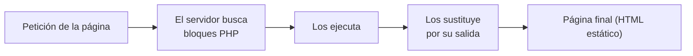

# UT1.- ARQUITECTURAS DE DESARROLLO WEB 
## 1.- Modelos de programación Cliente-Servidor 
Las aplicaciones web se basan en el modelo cliente-servidor. Es un modelo 
distribuido  en  el  que  hay  dos  tipos  de  elementos  con  funciones 
diferenciadas: clientes y servidores. 
· Los servidores proveen servicios, como información o funcionalidad, a los 
clientes. 
· Es el cliente el que inicia el proceso al enviar una solicitud al servidor que, a 
su vez, envía un mensaje de respuesta. 

Cliente y servidor se comunican mediante un protocolo que 
define el formato de solicitudes y respuestas y, en general, se 
ejecutan en máquinas diferentes conectadas por red. También pueden 
ejecutarse en el mismo ordenador.

La  comunicación entre clientes y servidores web se 
realiza mediante el protocolo HTTP o su versión segura HTTPS, que tienen 
los puertos reservados 80 y 443 respectivamente en la lista de puertos bien 
conocidos. 

La arquitectura a tres capas es una ampliación del modelo cliente-servidor. 
La lógica de aplicación se separa en: 
a)Capa  de  presentación.  Para  la  interfaz  de  usuario.  Muestra 
información y permite interactuar con el sistema usuario. 
b)Capa de negocio. Para la lógica propia de la aplicación. Se comunica 
con las otras dos capas. 
c)Capa de datos. Para gestionar la base de datos.

 >[!important]  La capa de presentación no se comunica directamente con la de datos, sino que se hace a través de la capa de negocio. 

Responsabilidades de cada una de las capas: 
·Capa  de  presentación:  comprende  las  responsabilidades  de  la 
presentación, como navegabilidad del sistema, validación de datos 
de entrada, formateo de los datos de salida, internacionalización, 
renderizado de presentación, etc 
·Capa de negocio: Comprende las responsabilidades de la lógica de 
negocio (o dominio) del sistema. El resultado del análisis funcional, 
conjunto de reglas de negocio que abstraen el mundo real. La capa de negocio ha de ser independiente de la capa de 
presentación y viceversa (en la medida de lo posible) 
·Capa de persistencia o datos: Comprende las responsabilidades de 
lógica de persistencia de las entidades que maneja el sistema en 
desarrollo: Inserción, Eliminación, Actualizaciones, Búsquedas, etc, 
no tiene porqué tratarse necesariamente de una base de datos 
relacional.

Definiciones Front-end, Back-end, Full stack 
·Front-end: Es la parte del desarrollo que se encarga del diseño y 
maquetación de la aplicación web utilizando tecnologías como HTML, 
CSS y Javascript (y sus frameworks). En este caso debe preocuparse 
también de la correcta presentación en cualquier tipo de dispositivo 
e incluso del posicionamiento en buscadores 
·Back-end: Es la parte del desarrollo que se encarga del lado servidor 
utilizando tecnologías como PHP, JSP y Python. También se encarga 
de la administración del servidor de aplicaciones y la Base de Datos. 
·Full stack: En un perfil que engloba los dos anteriores. En este caso 
el desarrollador quizás no es un experto de ninguna tecnología 
concreta, pero tiene amplios conocimientos de todo el conjunto y es 
capaz de colaborar en cualquiera de las partes. 

---

### 1.2.- Generación dinámica de páginas web 
El lenguaje básico para la web es HTML.  
Una página que esté escrita solo en HMTL será estática. Se mostrará 
siempre el mismo contenido. 
Cuando se utiliza un lenguaje de programación en el servidor se pueden 
generar páginas en función de la solicitud del cliente páginas webs 
dinámicas. 
Para ejecutar código en un servidor web hay varias opciones. La más 
habituales son: 
 
·Common Gateway Interface (CGI). Las peticiones de los clientes se 
pasan a un ejecutable en el servidor. Este programa genera la salida 
y el servidor se la pasa al cliente.

·Como módulo del servidor web. En lugar de utilizar un programa 
externo, el propio servidor cuenta con un módulo, generalmente un 
intérprete, para ejecutar código. 
 
·Servlets. Los servlets de Java son objetos que reciben una petición y 
devuelven una respuesta en función de la petición. Para utilizar 
servlets hace falta un contenedor web, que es el que interactúa con 
ellos. 

#### 1.2.1.- Lenguajes de programación en entornos servidor. Lenguajes de 
scripting 
Se entiende por lenguaje de scripting o de guiones (o embebido) aquel que 
se intercala con el código HTML que forma una aplicación web. 
Para que estas porciones de código sean ejecutadas, el agente que actúa de 
servidor (servidor web) debe tener instalado un módulo (scripting engine) 
que sea capaz de reconocer e interpretar el lenguaje en el que se programa 
dicho código. 
Hay muchos lenguajes para el lado del servidor. Los más habituales son: 
·PHP. Sin duda, el lenguaje más extendido en el lado servidor. 
·JSP. La versión Java de PHP. Para utilizarlo hace falta un contenedor 
web. 
·ASP.NET.  La  alternativa  a  PHP  de  Microsoft,  integrada  en  la 
plataforma .NET 
·PERL. Es un lenguaje especialmente pensado para el procesamiento 
de expresiones regulares. 
·Ruby. Es un lenguaje orientado a objetos.

#### 1.2.2.- Integración con los lenguajes de marcas 
Las páginas dinámicas se componen de: 
·Una parte estática en HTML 
·Una parte dinámica en algún lenguaje de programación 
Cuando se solicita una página: 
1.  El servidor busca en ella bloques de código.  
2. Si los encuentra los ejecuta y los sustituye por su salida.
---

## 2.- Páginas web estáticas y dinámicas. Evolución de la Web 
### 2.1.- WEB 1.0 
La Web 1.0 empezó en los años 60's junto a Internet, de la forma más básica 
que existe, con navegadores de solo texto, como ELISA, era bastante rápido 
pero muy simple. Después en los 90 surgió HTML (Hyper TextMarkup 
Language) como lenguaje hipertexto e hizo que las páginas Web sean más 
agradables a la vista y puedan contener componentes como imágenes, 
formatos y colores. Los primeros navegadores visuales fueron Netscape e 
Internet Explorer. 
 
Esta Web es de solo lectura WEB ESTÁTICA, ya que el usuario no puede 
interactuar con el contenido de la página (ningún comentario, respuesta, 
etc). Estando la información totalmente limitada a lo que el Webmaster 
(administrador) pueda publicar. 

### 2.2.- WEB 2.0 
La Web 2.0 es un concepto que se originó en una sesión de brainstorming 
entre Dale Dougherty de O’Really y Craig Cline de MediaLive International, 
quienes  estaban  preparando  una conferencia y decidieron  hablar del 
renacimiento de la Web después de la crisis de los “.com” en 2001. 
A partir de estas ideas, en una conferencia en octubre de 2004, caracterizan 
a la Web 2.0 como una nueva actitud o evolución de la Internet, que se 
resumía en tres principios básicos: 
·La web como plataforma. 
·La inteligencia colectiva. 
·La arquitectura de la participación. 
Una segunda generación en la historia del desarrollo de tecnología Web, 
basada en comunidades de usuarios y en una amplia gama de herramientas, 
como las redes sociales, blogs o wikis, que fomentan la colaboración y el 
intercambio de información. La Web 2.0 es también llamada Web social por el enfoque colaborativo y de construcción social de esta herramienta, donde el usuario es el ente más importante de información.

### 2.3.- WEB 3.0 
La Web 3.0 es considerada también como una extensión de Web Semántica 
definida por el premio Nobel Sir Timothy “Tim” John Berners – Lee. Y trata 
de poder enriquecer la comunicación mediante metadatos semánticos 
(ontologías) que aportan un valor añadido a la información, la diferencian y 
la hacen más inteligente. Por lo que los contenidos ahora ya no son tratados 
por su sintáctica sino por su semántica. 
Una posible definición de Web 3.0 sería la siguiente: Aquellas plataformas 
o herramientas online que no sólo permiten la conversación e interacción 
entre sus usuarios, sino que además son capaces de actuar de forma 
proactiva. La Web 3.0 usa Internet para conectar información. Hace la Web más inteligente, teniendo en cuenta nuestros gustos, preferencias, hábitos e incluso el contexto. Páginas capaces de comunicarse con otras páginas mediante el lenguaje natural, dando lugar a esa llamada Web Semántica. 

### 2.4.- WEB 4.0 
La Web 4.0 es un término que se va acuñando recientemente y trata de 
movernos hacia una Web Ubicua donde el objetivo primordial será el de 
unir las inteligencias, para que tanto las personas como las cosas se 
comuniquen entre sí para generar la toma de decisiones.  
Se  trata  de  una  web  activa.  Por  ejemplo, hasta  la  fecha,  el  uso  de 
buscadores es algo importante, ya que brindan información (páginas web) 
sobre lo que un usuario busca o escribe. Sin embargo, la web 4.0 será 
mucho más activa y funcionará como un asistente virtual con inteligencia 
artificial. Una persona puede decir "quiero una reservación en un hotel en 
el centro de Lima para el 15 de agosto". Entonces, el asistente entenderá el 
lenguaje y directamente reservará lo solicitado, basándose en reservas 
previas, gustos, presupuestos comunes u otros factores propios del usuario. 
Por otro lado, la web también se volverá mucho más interactiva. Puede 
reservar una entrada al cine para el estreno de la película favorita de un consumidor  y  solo  necesitará  su  confirmación  para  hacer  los  pagos respectivos. ¿Cómo es posible lograrlo? La gran cantidad de información gracias al big data, el aprendizaje automático y la mejora de asistentes actuales como Cortana o Siri permitirán una máximapersonalización y optimización de tareas. 

---

## 3. HERRAMIENTAS PARA EL DESARROLLO
 Existen dos tipos de programas para escribir código:
  ● Editores de código:
   Programas ligeros que no exigen mucha RAM o CPU donde puedes abrir y crear archivos y guardarlos en carpetas. A un editor se le pueden añadir plugins para realizar muchas más funciones. 
   
  ● Entornos de desarrollo integrado o IDEs (Integrated Development Environment):
   Programas más pesados que exigen más RAM y CPU pues sirven para trabajar en proyectos completos. Contienen herramientas integradas como compiladores, emuladores, control de versiones y terminales etc. Los más conocidos son: 
    ○ Netbeans Tiene un gran número de funciones, es gratuito y tiene soporte para idiomas. Su versión gratuita data del año 2010 después de que Sun Microsystems la lanzara en código abierto. Cuenta con una de las mayores comunidades de desarrolladores. Se puede utilizar con frameworks como Zend, Doctrine, Smarty y Symfony2.
    ○ PHPStorm No es considerado el nº 1 porque la mayoría de sus utilidades son de pago. Desarrollado por JetBrains, funciona con los principales frameworks (Symfony, Zend, Yii, CakePHP, Laravel) y con los principales sistemas CMS como Drupal, Magento y Wordpress. Ofrece además edición en directo con tecnologías como CSS, HTML, JavaScript y TypeScript. 
    ○ Eclipse También de código abierto, posee una enorme comunidad de desarrolladores que trabajan en todo tipo de plugins necesarios para ponerlo a la altura de otros IDEs. Su configuración no es sencilla y depende del gusto del usuario para su configuración. Como aspecto negativo cabe destacar su lentitud. Sus características clave incluyen el resaltado de sintaxis, ayuda de código, formateador de código, refactorización, plantillas de código, navegación de código, depuración de PHP, validación de sintaxis, etc. 
    ○ Sublime Text 3 Soporta una enorme cantidad de lenguajes y tiene una gran capacidad de adaptación a ellos. Es ligero, cuenta con multitud de funciones y es compatible con Windows, OSX y Linux. Su principal poder reside en la potencia de sus plugins y paquetes. No tiene nada que envidiar a editores de pago. 
    
---

## 4. SERVIDORES WEB
 El cometido principal de un servidor web es servir páginas, es decir, proveer de contenido estático a un cliente que ha realizado una petición a través de un navegador. Para ello carga un archivo y lo sirve mediante la red al navegador del solicitante. Con respecto a las peticiones de los clientes existen distintos métodos para intercambiar información entre cliente y servidor:
  ● Método GET: Método de invocación en el que el cliente le solicita al servidor web que le devuelva la información identificada en la propia URL, lo más común es que las peticiones se refieran a documentos HTML o imágenes, pero también pueden ser programas de bases de datos. 
  ● Método POST: Se usa para enviar información a un servidor web, por ejemplo al enviar el contenido de un formulario de autenticación o de registro en una web, así como de entradas de datos o especificar parámetros para algún tipo de componente ejecutado en el servidor. 


---

# 🐘 UT2.- LENGUAJE PHP. INSERCIÓN DE CÓDIGO EN PÁGINAS WEB

**Desarrollo web en entorno servidor (2ºDAW)**

> [!abstract] Resultados de aprendizaje
> **2.** Escribe sentencias ejecutables por un servidor Web reconociendo y aplicando procedimientos de integración del código en lenguajes de marcas.
>
> **Criterios de evaluación:** mecanismos de generación de páginas Web con código embebido · tecnologías asociadas · etiquetas para incluir código en el lenguaje de marcas · sintaxis del lenguaje · sentencias simples y sus efectos en el documento resultante · directivas para modificar el comportamiento predeterminado · tipos de variables y operadores · ámbitos de las variables · diseño de aplicaciones web sencillas.

> [!info] Índice de contenido
> 1. Estructura de los contenidos
> 2. PHP y HTML. Código incrustado
>     - 2.1. Cómo ejecutar el código para visualizarlo en el navegador
>     - 2.2. Sintaxis de PHP
>     - 2.3. Variables y tipos de dato
>         - 2.3.1. Declaración de variables
>         - 2.3.2. Asignación por copia y por referencia
>         - 2.3.3. Variables no inicializadas
>         - 2.3.4. Constantes
>         - 2.3.5. Tipos de datos escalares
>         - 2.3.6. Ámbito de las variables
>         - 2.3.7. Variables predefinidas
>     - 2.4. Comentarios
>     - 2.5. Expresiones y operadores en PHP
>     - 2.6. Funciones nativas de PHP
> 3. Glosario de términos
> 4. Anexos – Ampliación de funciones nativas PHP
> 5. Referencias bibliográficas

---

## 1.- Estructura de los contenidos

En este tema de introducción al lenguaje PHP, conoceremos la sintaxis básica, entenderemos cómo se integran PHP y HTML, además de describir los tipos de datos existentes y conocer algunas de las funciones más usadas en este lenguaje.

> [!note]
> Para ejecutar un programa en PHP necesitamos guardarlo dentro de un servidor web.

---

## 2.- PHP y HTML. Código incrustado

PHP (acrónimo recursivo de **P**HP: **H**ypertext **P**reprocessor) es un lenguaje de programación para desarrollo web en el lado servidor. Desde su aparición en 1994 ha tenido gran aceptación y se puede decir que es uno de los lenguajes más utilizados.

- El lenguaje PHP es flexible y permite programar pequeños *scripts* con rapidez.
- Comparado con lenguajes como Java, requiere escribir menos código y, en general, resulta menos engorroso.
- Las páginas de PHP contienen HTML con código incrustado que hace "algo".

El código de PHP está encerrado entre las etiquetas especiales de comienzo y final `<?php` y `?>` que permiten entrar y salir del "modo PHP".

**Ejemplo: `hola_mundo.php`**

Página HTML completa con un bloque PHP incrustado (líneas 7-9). El bloque tiene una única sentencia que sirve para mostrar la cadena "Hola mundo":

```html
<!DOCTYPE html>
<html lang="es">
    <head>
        <meta charset="UTF-8">
        <title>Hola mundo</title>
    </head>
    <body>
        <?php
        echo "Hola mundo";
        ?>
    </body>
</html>
```

Al solicitar la página al servidor web, se observa que el servidor web ha modificado una parte del fichero: **el bloque PHP ha desaparecido y en su lugar aparece "Hola Mundo"**.

> [!important]
> El servidor web procesa los bloques de PHP y los sustituye por su salida, es decir, por lo que muestran las sentencias del bloque. Si se consulta el código fuente de la página (pulsando **Ctrl + U**), solo se ve HTML: el código PHP nunca llega al navegador.

En este caso se utiliza la palabra reservada **`echo`**, que muestra el valor de una variable o de una cadena de texto.



> [!tip]
> Cuando un fichero contiene solo PHP se recomienda **no cerrar la etiqueta del último bloque**. Puede dar problemas si la respuesta del servidor involucra varios ficheros.
> Referencia: https://www.php.net/manual/es/language.basic-syntax.instruction-separation.php

### 2.1.- Cómo ejecutar el código para visualizarlo en el navegador

Para probar el programa lo hacemos de dos formas:

**1) Directamente en el servidor web (Apache)**

- Creando la página dentro de la carpeta `c:/xampp/htdocs/` e iniciando el servidor Apache del XAMPP.
- Por ejemplo, creamos `hola.php` con el código anterior; para probar la ejecución pondremos `http://localhost/hola.php` en el navegador.

**2) Utilizando NetBeans**

1. Creamos un proyecto nuevo: menú **File → New Project**, se selecciona **PHP → PHP Application** y se pulsa *Next*.
2. Se añade el nombre del proyecto, la ubicación y se elige la codificación (en el ejemplo, dentro de la carpeta de XAMPP: `c:/xampp/htdocs/proyecto1`).
3. En el siguiente paso se configura desde dónde se va a ejecutar:
   - **Apache de XAMPP:** el proyecto debe estar en `c:/xampp/htdocs/` y la URL del proyecto es `http://localhost/proyecto1` (el nombre de la carpeta donde está lo que se va a ejecutar).
   - **Servidor PHP de NetBeans:** da igual la ubicación del proyecto; se ejecuta en la URL `http://localhost:8000`. El proyecto se ejecutará en el *hostname* que digamos y el puerto que elijamos.

> [!note]
> Por defecto, NetBeans nos crea el proyecto con un `index.php` (o no).
> Todos los proyectos deberán tener un `index.php`, que es la página que se inicia por defecto al poner el nombre de la URL del proyecto en el navegador: `http://localhost/proyecto1/`
> Si las páginas tienen otro nombre, para que se ejecuten pondremos `http://localhost/proyecto1/nombrepagina.php`

### 2.2.- Sintaxis de PHP

El elemento básico en PHP es el **bloque**. Un bloque PHP está delimitado por las etiquetas correspondientes y contiene una serie de **sentencias separadas por punto y coma**.

### 2.3.- Variables y tipos de dato

Una de las características principales de PHP es que es un lenguaje **no fuertemente tipado**: no es necesario indicar el tipo de dato al declarar una variable.

De hecho, las variables no se declaran, **se crean la primera vez que se les asigna un valor**. El tipo de dato depende del valor con que se inicialicen.

Esto agiliza la escritura de programas, pero también tiene inconvenientes: si no se presta atención, puede dar lugar a código de baja calidad y, a medida que las aplicaciones crecen, pueden darse errores difíciles de depurar.

- Manual: https://www.php.net/manual/es/language.variables.php

#### 2.3.1.- Declaración de variables

En PHP los identificadores de las variables van siempre precedidos por el carácter **`$`**.

El identificador de la variable debe comenzar por:

- Una letra
- Un guión bajo (`_`)

Dicho identificador puede estar formado por números, letras y guiones bajos.

Para declarar una variable, sólo hay que asignarle un valor:

```php
$nombre = valor;
```

Por ejemplo, esta sentencia declara la variable `$entero`, que será de tipo `integer` porque se inicializa con un entero:

```php
$entero = 4;
```

También es posible cambiar el tipo de dato de una variable simplemente asignándole un valor de otro tipo de dato.

#### 2.3.2.- Asignación por copia y por referencia

En principio, la asignación de variables se realiza mediante **copia**. Si hacemos:

```php
$a = $b;
```

Se crea una nueva variable `$a` y se le asigna el valor que tenga `$b`. Las variables `$a` y `$b` representan **posiciones diferentes de memoria**, aunque tengan el mismo valor después de la asignación.

También es posible definir una **referencia** a una variable utilizando el operador ampersand (`&`):

```php
$var2 = &$var1;
```

En este caso `$var2` no es una nueva variable con el valor de `$var1`. Por el contrario, `$var2` apunta a la **misma dirección de memoria** que `$var1`, de manera que `$var1` y `$var2` son en realidad dos nombres para el mismo dato.

- Manual: https://www.php.net/manual/es/language.operators.assignment.php

#### 2.3.3.- Variables no inicializadas

> [!warning]
> Si una variable no inicializada aparece dentro de una expresión, ésta se calcula tomando el **valor por defecto** para ese tipo de dato.

Si se intenta utilizar una variable antes de asignarle un valor, se genera un error de tipo **`E_NOTICE`**, pero **no se interrumpe la ejecución** del script.

- Manual: https://www.php.net/manual/es/language.variables.basics.php

#### 2.3.4.- Constantes

Para definir constantes se utiliza la función **`define()`**, que recibe el nombre de la constante y el valor que queremos darle:

```php
define("LIMITE", 1000);
```

> [!tip]
> Es habitual utilizar identificadores en **mayúscula** para las constantes.

- Manual: https://www.php.net/manual/es/language.constants.php

#### 2.3.5.- Tipos de datos escalares

PHP ofrece **cuatro tipos de datos escalares**:

| Tipo | Descripción |
|---|---|
| **integer** | Números enteros |
| **float** | Números reales (decimales) |
| **boolean** | Verdadero o falso |
| **string** | Cadenas de caracteres |

##### A) Números

Para representar números enteros se usa el tipo de dato `integer`. El tamaño y los valores máximo y mínimo de un entero dependen de la plataforma, y se pueden conocer mediante las constantes:

- `PHP_INT_SIZE`
- `PHP_INT_MAX`
- `PHP_INT_MIN`

Para números reales, se utiliza el tipo `float`. Suele ofrecer una **precisión de 14 decimales** (aunque dependerá de la plataforma).

> [!note]
> La conversión entre `integer` y `float` es **automática**. También se pueden utilizar los operadores de conversión `(int)` o `(float)`.

- Manual: https://www.php.net/manual/es/language.types.intro.php

##### B) Cadenas

El tipo de dato `string` permite almacenar cadenas de caracteres. Para delimitar una cadena es posible utilizar comillas simples o dobles, pero hay una diferencia:

- Si se utilizan **comillas dobles** (también llamadas *comillas mágicas*), las variables que aparezcan dentro de la cadena **se sustituirán por su valor**.

```php
$nombre = "Mundo";
echo "Hola $nombre";   // Hola Mundo
```

##### C) Booleanos

Este tipo de datos es para variables booleanas. Solo pueden tomar valores **`TRUE`** o **`FALSE`**.

Es el tipo de dato que se obtiene, entre otros casos, como resultado de los operadores de comparación y se utiliza en sentencias condicionales y bucles.

Cuando se espera un valor booleano y se recibe otro tipo de dato, se aplican las reglas de conversión recogidas en el cuadro siguiente:

| Tipo | Valor como boolean |
|---|---|
| `integer` | Si es `0` se toma `FALSE`, en otro caso `TRUE` |
| `float` | Si es `0.0` se toma `FALSE`, en otro caso `TRUE` |
| `string` | Si es una cadena vacía o `"0"`, se toma como `FALSE`, en otro caso `TRUE` |
| Variables no inicializadas | `FALSE` |
| `null` | `FALSE` |
| `array` | Si no tiene elementos se toma `FALSE`, en otro caso `TRUE` |

##### D) Otros tipos de dato (tipos compuestos y especiales)

Además de los tipos de datos escalares, en PHP también existen los siguientes tipos de datos:

| Tipo | Descripción |
|---|---|
| **array** | Para representar colecciones de elementos. |
| **object** | PHP tiene soporte completo para la programación orientada a objetos. |
| **callable** | Un tipo de dato especial para representar funciones de *callback*, funciones que se pasan a otras funciones. |
| **null** | Representa una variable que no ha sido asignada. Solo puede tomar un único valor, `NULL`. Se considera que una variable es de tipo `null` si se le asigna el valor `NULL` o no está inicializada. |
| **resource** | Representa recursos externos, como una conexión a una base de datos. |

#### 2.3.6.- Ámbito de las variables

El **ámbito** de una variable es la parte de código en que ésta es visible.

- Una variable declarada en un fichero PHP está disponible en ese fichero y en los ficheros que se incluyan desde este.
- Las funciones definen un **ámbito local**: las variables que se declaran en las mismas solo son accesibles desde la propia función. Además, desde la función no se puede acceder a otras variables que no sean las locales o sus argumentos.
- Para definir **variables globales** hay dos opciones:
    - La palabra reservada `global`
    - La variable predefinida `$_GLOBALS`

- Manual: https://www.php.net/manual/es/language.variables.scope.php

#### 2.3.7.- Variables predefinidas

En PHP hay muchas variables predefinidas disponibles. Contienen información sobre el servidor, datos enviados por el cliente o variables de entorno.

Dentro de las variables predefinidas hay un grupo de ellas, las **superglobales**, que están disponibles **en cualquier ámbito**. Cada una de ellas guarda información de un tipo.

Por ejemplo, en `$_SERVER` hay información sobre el servidor en el que está alojada la página. El script siguiente muestra algunos de los datos disponibles:

```php
<?php
echo "<pre>";
print_r($_SERVER);
echo "</pre>";
?>
```

> [!important]
> Las variables superglobales son muy relevantes para el desarrollo de aplicaciones web y se irán poniendo en práctica a lo largo del curso.

- Manual: https://www.php.net/manual/es/language.variables.superglobals.php

---

### 2.4.- Comentarios

En PHP se pueden utilizar comentarios:

- **De bloque**, encerrados entre `/*` y `*/`
- **De línea**, comenzando por `//` o por `#`

```php
/* Este es un
   comentario de bloque */

echo "Hola"; // comentario de línea
echo "Adiós"; # también vale con almohadilla
```

> [!tip]
> Como cualquier lenguaje, comentar adecuadamente el código se considera una buena práctica de programación.

- Manual: https://www.php.net/manual/es/language.basic-syntax.comments.php

---

### 2.5.- Expresiones y operadores en PHP

#### 2.5.1.- Expresiones

Las expresiones son los bloques de construcción más importantes de PHP. En PHP casi todo lo que se escribe es una expresión. La manera más simple y acertada de definir lo que es una expresión es **«cualquier cosa que tiene un valor»**.

Las formas más básicas de expresiones son las **constantes** y las **variables**.

- Ejemplo: al escribir `$a = 5` se está asignando `5` a `$a`. `5` tiene el valor 5, es decir, `5` es una expresión con el valor 5 (en este caso, una constante entera).
- Después de esta asignación, se espera que el valor de `$a` sea 5 también, por lo que si se escribe `$b = $a`, se espera que esto se comporte tal como si se escribiera `$b = 5`. En otras palabras, `$a` es también una expresión con el valor 5.
- Un ejemplo de expresiones algo más complejo son las funciones.

- Manual: https://www.php.net/manual/es/language.expressions.php

#### 2.5.2.- Operadores

PHP cuenta con los operadores habituales para operaciones aritméticas, lógicas, de manipulación de cadenas y demás.

##### Operador de asignación

- **`=`** — Lo utilizamos para asignar un valor a una variable.

##### Operadores aritméticos

Nos permiten realizar operaciones numéricas con nuestras variables:

| Operador | Nombre | Ejemplo |
|---|---|---|
| `+` | Suma | `$suma = $a + $b;` |
| `-` | Resta | `$resta = $a - $b;` |
| `*` | Multiplicación | `$mul = $a * $b;` |
| `/` | División | `$divi = $a / $b;` |
| `%` | Módulo (resto de la división) | `$resto = $a % $b;` |
| `**` | Exponenciación (`2 ** 3`, elevar 2 a la tercera potencia) | `$expo = $a ** 3;` |

##### Operadores de asignación con una operación asociada

Permiten realizar una operación y una asignación en un único paso:

| Operador | Ejemplo | Descripción |
|---|---|---|
| `+=` | `$suma += 5;` | Suma y asignación |
| `-=` | `$resta -= 10;` | Resta y asignación |
| `*=` | `$fact *= $a;` | Multiplicación y asignación |
| `/=` | `$divi /= 10;` | División y asignación |
| `%=` | `$resul %= $b;` | Módulo y asignación |
| `.=` | `$cadena .= "concateno";` | Concatenación y asignación |

##### Operadores de comparación

Se utilizan principalmente en las condiciones para comparar dos variables:

| Operador | Descripción |
|---|---|
| `==` | Comprueba si son iguales |
| `!=` | Comprueba si son distintos |
| `===` | Comprueba si son iguales y de exactamente el mismo tipo (**Idéntico**) |
| `!==` | Comprueba si son distintos o de distinto tipo (**No idéntico**) |
| `<>` | Diferente (igual que `!=`) |
| `<` | Menor que |
| `>` | Mayor que |
| `<=` | Menor o igual |
| `>=` | Mayor o igual |
| `<=>` | **Comparador de orden**: `$a <=> $b` devuelve un entero menor que, igual a, o mayor que cero cuando `$a` es respectivamente menor que, igual a, o mayor que `$b`. Disponible a partir de PHP 7. |
| `??` | **Uno o el otro** (PHP 7): devuelve el primer operando de izquierda a derecha que exista y no sea `NULL`; `NULL` si no hay valores definidos y no son `NULL`. Por ejemplo `$a ?? $b ?? $c`. |

> [!important]
> Los operadores **`===`** (Idéntico) y **`!==`** (No idéntico) no están presentes en todos los lenguajes.
> Se diferencia el Idéntico del operador Igual (`==`) en que éste, cuando las expresiones no tienen el mismo tipo de dato, **intenta convertirlas antes de compararlas**.
> El operador Idéntico se usa para comparar dos expresiones y se evalúa como verdadero cuando las dos expresiones tienen **el mismo valor y además el mismo tipo de dato**.

##### Operadores lógicos

Sirven para realizar operaciones lógicas: al final van a devolver un "sí" o un "no". Se usan en combinación con los operadores de comparación cuando la expresión de la condición lo requiere:

| Operador | Descripción |
|---|---|
| `and` | Operación lógica "y": será verdadero si ambos son verdaderos |
| `or` | Operación lógica "o": será verdadero si uno de ellos es verdadero |
| `xor` | Operación lógica "xor": será verdadero si uno de ellos es verdadero, pero no ambos |
| `!` | Negación: si era verdadero pasa a falso y viceversa |
| `&&` | Operación lógica "y" |
| `\|\|` | Operación lógica "o" |

##### Operadores de incremento

Sirven para aumentar o disminuir en una unidad el valor de una variable. Son atajos para hacer una operación típica en los recorridos de bucles:

| Operador | Descripción |
|---|---|
| `++$a` | **Pre-incremento**: primero suma y luego asigna |
| `$a++` | **Post-incremento**: primero asigna y luego suma |
| `--$a` | **Pre-decremento**: primero resta y luego asigna |
| `$a--` | **Post-decremento**: primero asigna y luego resta |

Estos operadores realizan dos cosas: por un lado un incremento/decremento y por otro se devuelven ellos mismos como resultado del operador.

- Cuando tenemos un **pre-incremento o pre-decremento**, primero se realiza el incremento/decremento y luego se devuelve ese valor.
- Con el **post-incremento o post-decremento**, primero se devuelve el valor original y luego se realiza el incremento/decremento.

##### Operadores de cadenas

Cuando trabajamos con cadenas de caracteres tenemos un operador especial: el de la **concatenación**. Sirve para unir una cadena a la otra:

- **`.`** — Concatenación

##### Operadores para arrays

Se utilizan para comparar arrays (en el ejemplo, `$a` y `$b` son arrays):

| Ejemplo | Nombre | Resultado |
|---|---|---|
| `$a + $b` | Unión | Unión de `$a` y `$b`. El operador `+` devuelve el array del lado derecho añadido al array del lado izquierdo; para las claves que existan en ambos arrays, serán utilizados los elementos del array de la izquierda y serán ignorados los elementos correspondientes del array de la derecha |
| `$a == $b` | Igualdad | `TRUE` si `$a` y `$b` tienen las mismas parejas clave/valor |
| `$a === $b` | Identidad | `TRUE` si `$a` y `$b` tienen las mismas parejas clave/valor en el mismo orden y de los mismos tipos |
| `$a != $b` | Desigualdad | `TRUE` si `$a` no es igual a `$b` |
| `$a <> $b` | Desigualdad | `TRUE` si `$a` no es igual a `$b` |
| `$a !== $b` | No-identidad | `TRUE` si `$a` no es idéntica a `$b` |

- Manual: https://www.php.net/manual/es/language.operators.php

#### 2.5.3.- Orden de prioridad

Los operadores lógicos y matemáticos tienen un **orden de prioridad o precedencia**. Este es un esquema general que indica el orden en que deben evaluarse en la mayoría de los lenguajes de programación.

> [!tip]
> Lo aconsejable es que cuando se tenga una expresión con varios operadores y operandos se utilicen los **paréntesis**: así no dará lugar a dudas y no tendrá distintas interpretaciones.

- Manual: https://www.php.net/manual/es/language.operators.precedence.php

---

### 2.6.- Funciones nativas de PHP

En PHP ya existen en memoria funciones que nos permiten realizar distintas operaciones al invocarlas. Entre las más utilizadas están las que se detallan en los **Anexos** (§4): funciones numéricas, de cadenas, de tipos y de fechas.

- Listado de funciones nativas – PHP Manual: https://www.php.net/manual/es/indexes.functions.php

---

## 3.- Glosario de términos

| Término | Definición |
|---|---|
| **Array** | Es un tipo de dato compuesto habitual en los lenguajes de programación. Aunque los detalles varían entre lenguajes, en general, se parecen a vectores o listas ordenadas. |
| **Bucle** | Estructura de programación que permite repetir instrucciones. |
| **Estructura condicional** | Posibilita ejecutar o no una instrucción según se cumpla una condición. |
| **Función** | Conjunto de instrucciones que realiza una tarea concreta. |
| **Librería** | Las funciones relacionadas entre sí se agrupan en librerías o bibliotecas. |
| **Programación orientada a objetos** | Paradigma de programación basado en la idea de objetos, elementos que agrupan variables y funciones. |
| **Script** | Programa sencillo, habitualmente ejecutado por un intérprete en lugar de ser compilado. |
| **Variable** | Posición en la memoria del ordenador identificada por un nombre. La variable almacena datos. Estos datos son el valor de la variable. |

---

## 4.- ANEXOS – Ampliación de funciones nativas PHP

> [!tip]
> En ANEXOS se presentan muchas funciones predefinidas en PHP. Su uso puede facilitaros mucho la resolución de un problema mediante un *script* en PHP.

A continuación, se presentan funciones nativas de PHP que pueden ser de ayuda para programar *scripts* en este lenguaje.

### 4.1.- Numéricas

**`round()`**

Redondea: recibirá como parámetro un número y, si el valor después del punto (o de la coma) es menor a 50, redondeará para abajo; de lo contrario, lo hará un número más. Se pueden añadir número de dígitos de precisión poniendo `round($num, $precision)`.

```php
<?php
$numero = 1.49;
echo round($numero);        // 1
echo round(1.75);           // 2
echo round(3.14159, 2);     // 3.14
?>
```

**`floor()`**

Redondea siempre **para abajo**. Es muy útil a la hora de obtener promedios:

```php
<?php
$decimal = 1.50;
$decimal_redondeado = floor($decimal);
echo $decimal_redondeado;   // 1
?>
```

**`ceil()`**

Si queremos que el redondeo sea siempre **para arriba**:

```php
<?php
$decimal = 1.50;
$decimal_redondeado = ceil($decimal);
echo $decimal_redondeado;   // 2
?>
```

**`rand()`**

Genera un número al azar dentro de un rango desde/hasta. Por ejemplo, si quisiéramos devolver un número desde el 1 al 9 (inclusive):

```php
<?php
$numero_al_azar = rand(1, 9);
echo $numero_al_azar;       // p. ej.: 3
?>
```

Puede devolver cualquiera de los números de los rangos comprendidos.

### 4.2.- Cadenas

> [!note]
> Hay que tener en cuenta que el **primer carácter de una cadena ocupa la posición 0**.

**`strtoupper()`** — Convierte una cadena en mayúscula:

```php
<?php
$palabra = 'Me encantan las arepas venezolanas.';
$palabra_mayuscula = strtoupper($palabra);
echo $palabra_mayuscula;    // ME ENCANTAN LAS AREPAS VENEZOLANAS.
?>
```

**`mb_strtoupper($cadena [, string $encoding])`** — Convierte una cadena en mayúscula; a diferencia de lo anterior, la cadena puede tener tildes.

- El parámetro `encoding` es la codificación de caracteres. Si se omite, se usa la codificación interna (`mb_internal_encoding()`).
- La conversión se lleva a cabo según las propiedades de los caracteres **Unicode** y no se ve afectada por la configuración regional, por lo que puede convertir cualquier carácter con propiedad alfabética, como la `á`.

```php
<?php
$palabra = "Martín Martínez León";
echo mb_strtoupper($palabra);   // MARTÍN MARTÍNEZ LEÓN
echo strtoupper($palabra);      // MARTíN MARTíNEZ LEóN (no convierte los acentos)
?>
```

**`strtolower()`** — Convierte una cadena en minúsculas:

```php
<?php
$palabra = 'No GRITES, habla bajito.';
$palabra_minuscula = strtolower($palabra);
echo $palabra_minuscula;    // no grites, habla bajito.
?>
```

**`mb_strtolower($cadena [, string $encoding])`** — Igual que la anterior pero soportando tildes/caracteres Unicode.

**`ucfirst()`** — Convierte **sólo la primera letra** de una cadena en mayúscula:

```php
<?php
$palabra = 'fernando';
$nombre = ucfirst($palabra);
echo $nombre;               // Fernando
?>
```

Si la primera letra es acentuada, necesitamos extraer el primer carácter y convertirlo a mayúscula (`mb_strtoupper(mb_substr($nombr, 0, 1))`) y luego concatenar con el resto de la cadena (`mb_substr($nombr, 1)`).

**`ucwords()`** — Convierte en mayúscula los **primeros caracteres de cada palabra**:

```php
<?php
$palabra = 'fernando gonzalo gaitan';
$nombre_completo = ucwords($palabra);
echo $nombre_completo;      // Fernando Gonzalo Gaitan
?>
```

**`mb_convert_case(string $str, int $mode [, string $encoding])`** — Realiza una conversión a mayúsculas/minúsculas de acuerdo al modo especificado por `mode`, según las propiedades Unicode (no se ve afectada por configuraciones regionales).

- El modo de conversión puede ser `MB_CASE_UPPER`, `MB_CASE_LOWER` o `MB_CASE_TITLE`.

```php
<?php
$palabra = "Mi nombre es Martín Martín León";
echo mb_convert_case($palabra, MB_CASE_LOWER);
// mi nombre es martín martín león
echo mb_convert_case($palabra, MB_CASE_UPPER);
// MI NOMBRE ES MARTÍN MARTÍN LEÓN
echo mb_convert_case($palabra, MB_CASE_TITLE);
// Mi Nombre Es Martín Martín León
?>
```

**`strlen()`** — Devuelve la cantidad de caracteres que tiene una cadena:

```php
<?php
$cancion = 'De aquel amor de música ligera, nada nos libra, nada más queda';
$cantidad_de_caracteres = strlen($cancion);
echo $cantidad_de_caracteres;   // 64
?>
```

**`mb_strlen(string $str [, string $encoding])`** — Devuelve la cantidad de caracteres de una cadena que contiene caracteres Unicode:

```php
<?php
$palabra = "Martín Martín León";
echo strlen($palabra);      // 21 (cuenta bytes)
echo mb_strlen($palabra);   // 18 (cuenta caracteres)
?>
```

**`substr()`** — Permite seleccionar cuántos caracteres queremos mostrar de una cadena. Recibe tres parámetros: la cadena, a partir de qué carácter queremos que se muestre (empieza desde 0) y el número de caracteres:

```php
<?php
$cancion = 'De aquel amor de música ligera, nada nos libra, nada más queda';
$cancion_cortada = substr($cancion, 0, 11);
echo $cancion_cortada;      // De aquel am
?>
```

Si el inicio es **negativo**, la cadena devuelta empezará en el inicio que pongamos pero contando **desde el final de la cadena**.

**`mb_substr(string $str, int $start [, int $length [, string $encoding]])`** — Lo mismo, pero con caracteres Unicode.

**`mb_internal_encoding([string $encoding])`** — Establece/obtiene la codificación de caracteres interna. Por defecto es **UTF-8**.

**`trim()`** — Una de las funciones más usadas de PHP: corta los espacios en las cadenas tanto al principio como al final:

```php
<?php
$cadena = ' Hola ';
$cadena_cortada = trim($cadena);
echo strlen($cadena);           // 6
echo strlen($cadena_cortada);   // 4
?>
```

`trim()` no sólo funciona para eliminar espacios: puede eliminar cualquier tipo de carácter si le agregamos un segundo parámetro:

```php
<?php
$cadena = '///Hola///';
$cadena_cortada = trim($cadena, '/');
echo $cadena_cortada;       // Hola
?>
```

Los otros caracteres predefinidos pueden ser estos:

- `"\0"` — NULL
- `"\t"` — tab
- `"\n"` — new line
- `"\x0B"` — vertical tab
- `"\r"` — carriage return
- `" "` — ordinary white space

- https://www.php.net/manual/es/function.trim.php

**`ltrim($cadena)`** — Elimina espacios en blanco u otros caracteres predefinidos del **lado izquierdo** de una cadena.

**`rtrim($cadena)`** — Elimina espacios en blanco u otros caracteres predefinidos del **lado derecho** de una cadena.

**`substr_count($cadena, $cadenaabuscar)`** — Cuenta el número de apariciones de la cadena que escribimos en *cadena a buscar*. Muy útil para saber si una cadena está contenida en otra:

```php
<?php
$text = 'This is a test';
echo strlen($text);             // 14
echo substr_count($text, 'is'); // cuenta 2
?>
```

**`str_replace()`** — Busca una cadena específica y la reemplaza por otra:

```
str_replace(buscar, reemplazar, lacadena, count)
```

- `buscar` — Especifica el valor a encontrar
- `reemplazar` — Especifica el valor para reemplazar el valor en *buscar*
- `cadena` — Especifica la cadena que se buscará
- `contar` — Una variable que cuenta el número de reemplazos (*opcional*)

```php
<?php
$frase = 'Marge_creo_que_odio_a_Mickael_Jackson.';
$frase_modificada = str_replace('_', '-', $frase, $c);
echo $frase_modificada;   // Marge-creo-que-odio-a-Mickael-Jackson.
echo $c;                  // 6 (cambios)
?>
```

Se pueden modificar cadenas completas, no sólo un carácter:

```php
<?php
$frase = 'Una manzana y una manzana son dos manzanas';
$frase_modificada = str_replace('manzana', 'naranja', $frase);
echo $frase_modificada;   // Una naranja y una naranja son dos naranjas
?>
```

**`strtr($cadena, $from, $to)`** — Convierte caracteres o reemplaza *substrings*.

Si se dan tres argumentos, devuelve una copia de la cadena donde todas las apariciones de cada carácter en `from` han sido convertidas al carácter correspondiente en `to` (`$from[$n]` → `$to[$n]`). Si `from` y `to` tienen distinta longitud, se ignoran los caracteres extra del *string* más largo.

```php
<?php
$cadena = "Martín áé Martín úí León";
echo strtr($cadena, 'aet', 'AET');
// MArTín áé MArTín úí León
?>
```

- https://www.php.net/manual/es/function.strtr.php

**`strstr()`** — Encuentra la primera aparición de un *string*:

```
strstr(string $cadena1, string $cadena2) : string
```

Devuelve parte del *string* `cadena1` iniciando desde, e incluyendo, la primera aparición de `cadena2` hasta el final de `cadena1`.

> [!warning]
> Esta función es **sensible a mayúsculas**.

```php
<?php
$cadena1 = "Probando a buscar una cadena en otra cadena";
$cadena2 = "en otra";
$resultado = strstr($cadena1, $cadena2);
echo $resultado;            // en otra cadena
if (strstr($cadena1, $cadena2)) {
    echo $cadena2 . " Contenida en: " . $cadena1;
}
?>
```

- https://www.php.net/manual/es/function.strstr.php

**`strpos()`, `stripos()` y `strstr()`** sirven para encontrar subcadenas:

- **`strpos`** — Encuentra la **posición** de la primera ocurrencia de un *substring* en un *string*.
- **`stripos`** — Igual que `strpos`, pero **sin considerar mayúsculas ni minúsculas**.

```php
<?php
$mystring = 'abc';
$findme = 'a';
$pos = strpos($mystring, $findme);

// Nótese el uso de ===, puesto que == simple no funcionará como se espera
// porque la posición de 'a' está en el 1° (primer) carácter.
if ($pos === false) {
    echo "La cadena '$findme' no fue encontrada en la cadena '$mystring'";
} else {
    echo "La cadena '$findme' fue encontrada en la cadena '$mystring'";
    echo " y existe en la posición $pos";
}
?>
```

- https://www.php.net/manual/es/function.strpos.php

**`str_contains`** — Determina si una cadena contiene una subcadena dada (**PHP 8**):

```php
<?php
$string = 'The lazy fox jumped over the fence';

if (str_contains($string, 'lazy')) {
    echo "The string 'lazy' was found in the string\n";
}

if (str_contains($string, 'Lazy')) {
    echo 'The string "Lazy" was found in the string';
} else {
    echo '"Lazy" was not found because the case does not match';
}
?>
```

**`var_dump()`** — Muy útil en tiempo de desarrollo a la hora de testear datos, ya sea de una variable o de lo que devuelve una función. Devuelve la **estructura** de una variable cualquiera (tipo y valor):

```php
<?php
$cadena = 'Manzana';
$numero = 5;
$valor_logico = true;
$coleccion = array('Azul', 'Rojo', 'Verde');
echo '<pre>';
var_dump($cadena);
var_dump($numero);
var_dump($valor_logico);
var_dump($coleccion);
echo '</pre>';
?>
```

**`print_r()`** — Muestra información sobre una variable de una manera que sea **legible por humanos**. Similar a `var_dump`.

```php
<?php
echo '<pre>';
print_r($coleccion);
echo '</pre>';
?>
```

### 4.3.- De tipos

> [!note]
> El `false` o `null` no muestra nada a la hora de visualizar. Otro valor en una variable visualiza `1`, que es `true`.

**Funciones para convertir variables a otros tipos:**

| Función | Descripción |
|---|---|
| `boolval()` | Obtiene el valor booleano de una variable |
| `intval()` | Obtiene el valor entero de una variable |
| `floatval()` | Obtiene el valor flotante de una variable |
| `strval()` | Obtiene el valor de cadena de una variable |
| `settype()` | Establece el tipo de una variable |

```php
<?php
$v = boolval(121212); echo $v;   // 1 (true)
$v = boolval(0);      echo $v;   // "" (false)

$v = intval("ANBB");           // 0
$v = intval("323244.656");     // 323244
$v = floatval("323244.656");   // 323244.656
$v = strval(121212);           // "121212"

$a = "sffsfsfr";
settype($a, "integer");        // convierte $a a entero
settype($b, "string");         // convierte $b a cadena
?>
```

**Funciones para comprobar el tipo de las variables:**

| Función | Descripción |
|---|---|
| `is_int()` | Comprueba si el tipo de una variable es `integer` |
| `is_bool()` | Comprueba si una variable es de tipo booleano |
| `is_null()` | Comprueba si una variable es `NULL` |
| `is_float()` | Comprueba si el tipo de una variable es `float` |
| `is_numeric()` | Comprueba si una variable es un número o un *string* numérico |
| `is_string()` | Comprueba si una variable es de tipo `string` |
| `is_object()` | Comprueba si una variable es un objeto |
| `is_array()` | Comprueba si una variable es un `array` |

```php
<?php
$v = 121212;
if (is_int($v)) {
    echo "$v es int";
} else {
    echo "$v no es int";
}

$v = "121212";
if (is_numeric($v)) {
    echo "$v es numeric";   // sí, porque es un string numérico
}

$alum = array('Juan', 'Rosa', 'Ana');
if (is_array($alum)) {
    echo "es Array";
}
?>
```

> [!tip]
> Para ver el contenido de **arrays** y **objetos**, se utiliza `var_dump()` o `print_r()`.

### 4.4.- Fechas

En PHP se puede trabajar con fechas al igual que cualquier otro lenguaje de programación. Esto es muy útil para tener un control en nuestra aplicación web del tiempo.

**`date()`**

La función `date()` nos permite **formatear una fecha**, ya sea con el día, mes, año, horas, minutos, segundos, día de la semana, etc. Recibirá dos parámetros: el primero es el formato de la fecha que queremos mostrar, y un segundo parámetro **opcional** que es el *timestamp*.

```php
<?php
$fecha = date('d-m-Y');
echo $fecha;    // p. ej.: 07-09-2020 (día-mes-año)
?>
```

- `'Y'` hace referencia al año (*Year*), `'m'` al mes (*month*) y `'d'` al día (*day*): con `date('Y-m-d')` sale el formato en inglés año-mes-día.
- También podemos incluir hora (`H`), minutos (`i`) y segundos (`s`):

```php
<?php
$fecha_hora = date('d-m-Y H:i:s');
echo $fecha_hora;   // p. ej.: 07-09-2020 19:50:02
?>
```

- Si se pone en mayúscula el día y el mes, sale el **nombre**.

- https://php.net/manual/es/function.date.php

**`mktime()`**

Otra forma de recuperar la fecha y la hora en PHP es en formato **timestamp** (o marca de tiempo Unix): la cantidad de segundos que van desde la **época Unix (1 de Enero de 1970 a las 00:00:00)** hasta el momento en que se llama.

Esta función recibirá 6 parámetros: **la hora, los minutos, los segundos, el mes, el día y el año** (en ese orden):

```php
<?php
$mktime1 = mktime('19', '50', '02', '09', '07', '2020');
echo $mktime1;   // 1599501002 → 7 de septiembre de 2020, 19:50:02

$mktime2 = mktime('18', '50', '02', '09', '07', '2020');
$resta = $mktime1 - $mktime2;
echo $resta;     // 3600 (segundos de diferencia entre ambas horas)
?>
```

Para devolver la fecha y la hora a través de un valor timestamp, `date()` recibirá un segundo parámetro con la fecha que deberá formatear:

```php
<?php
$fecha = date('d-m-Y H:i:s', 1599501002);
echo $fecha;     // 07-09-2020 19:50:02
?>
```

**`time()`**

Devuelve un valor de tipo timestamp del **momento en que la estamos llamando**:

```php
<?php
$tiempo = time();
$fecha = date('d-m-Y H:i:s');
echo $tiempo;    // p. ej.: 1594210589
echo $fecha;     // p. ej.: 08-07-2020 14:16:29
?>
```

**`strtotime()`**

Hasta ahora hemos pasado fechas *timestamp* a `date()` en formato de fecha normal; si lo que queremos es hacer la **inversa** (de fecha normal a timestamp), usamos `strtotime()`:

```php
<?php
$fecha = '10-09-2020 20:09:33';
$timestamp = strtotime($fecha);
echo $timestamp;   // 1599761373
?>
```

**`checkdate()`**

Introduce las **validaciones**: valida que una fecha sea correcta. Recibe tres parámetros: **mes, día y año**, en ese orden. Si la fecha es correcta devolverá `true`, sino `false`:

```php
<?php
$dia = 31;
$mes = 11;
$anio = 1986;

if (checkdate($mes, $dia, $anio)) {
    echo 'La fecha es correcta';
} else {
    echo 'La fecha es incorrecta';   // ← este caso
}
?>
```

Porque obviamente el 31 de noviembre de 1986 no es una fecha correcta: el mes de noviembre tiene hasta el día 30.

---

## 5.- Referencias bibliográficas

- Sanz, M. L. *Programación Web en el Entorno Servidor* (MF0492_3). Grupo Editorial RA-MA.
- Ganzábal, Xabier. *Desarrollo web en entorno servidor*. Editorial Síntesis.
- PHP. Manual oficial de PHP: https://www.php.net/manual/es/index.php


---

# 🔁 UT3.- ESTRUCTURAS DE CONTROL, ARRAYS Y FORMULARIOS

**Desarrollo web en entorno servidor (2ºDAW)**

> [!abstract] Resultados de aprendizaje
> **3.** Escribe bloques de sentencias embebidos en lenguajes de marcas, seleccionando y utilizando las estructuras de programación.
>
> **Criterios de evaluación:** mecanismos de decisión en la creación de bloques de sentencias · bucles y verificación de su funcionamiento · "arrays" para almacenar y recuperar conjuntos de datos · creación y uso de funciones · formularios web para interactuar con el usuario · métodos para recuperar la información introducida en el formulario · comentarios al código · herramientas y entornos para programar, probar y depurar el código.

> [!info] Índice de contenido
> 1. Estructura de los contenidos
> 2. Estructuras de control
>     - 2.1. Estructuras condicionales
>     - 2.2. Estructuras de repetición
>         - 2.2.1. Bucle for
>         - 2.2.2. Bucle while
>         - 2.2.3. Bucle do-while
>         - 2.2.4. Otras estructuras de control
> 3. Arrays
>     - 3.1. Operadores y arrays
> 4. Funciones y librerías
>     - 4.1. Funciones predefinidas
>     - 4.2. Funciones definidas por el usuario
>     - 4.3. Paso de parámetros por copia y por referencia
>     - 4.4. Funciones como argumentos
> 5. Excepciones y errores
> 6. Formularios
>     - 6.1. Formulario de login
>     - 6.2. Formulario y procesamiento en un solo fichero
> 7. Glosario de términos
> 8. Referencias bibliográficas

---

## 1.- Estructura de los contenidos

En este tema profundizamos un poco más en el conocimiento del lenguaje PHP. Aprenderemos a utilizar las estructuras de control, arrays y los formularios.

---

## 2.- Estructuras de control

Antes de comenzar, debemos preguntarnos lo siguiente: **¿qué es el flujo de un documento PHP?**

PHP cuenta con las estructuras de control habituales en la programación estructurada para realizar sentencias **condicionales o de selección** y **de repetición**. La sintaxis es muy parecida a la de Java o C.

### 2.1.- Estructuras condicionales

Las estructuras condicionales de PHP son:

- `if`
- `if-else`
- `if-elseif`
- `switch`

La sintaxis general es:

```php
if (condición) {
    // instrucción
}
```

> [!note]
> Si se cumple la condición, se ejecuta la instrucción. Si no se cumple, no se ejecuta.
> Para agrupar dentro del `if` más de una sentencia, se encierran **entre llaves**.
> La condición es una expresión que se evalúa a **verdadero o falso**, siguiendo las normas de conversión a *boolean* si es necesario.

**Ejemplo con `if-else`:**

```php
<?php
$edad = 20;
if ($edad >= 18) {
    echo "Eres mayor de edad";
} else {
    echo "Eres menor de edad";
}
?>
```

Si se anidan varias sentencias condicionales, se puede usar **`elseif`**, que es equivalente a `else if`:

```php
<?php
$nota = 7;
if ($nota < 5) {
    echo "Suspenso";
} elseif ($nota < 7) {
    echo "Aprobado";
} elseif ($nota < 9) {
    echo "Notable";
} else {
    echo "Sobresaliente";
}
?>
```

- Manual: https://www.php.net/manual/es/control-structures.if.php

**`switch`**

Para agrupar varios `if` puede ser útil la estructura **`switch`**, también habitual en otros lenguajes:

```php
<?php
$var = 2;
switch ($var) {
    case 1:
        echo "Es un uno";
        break;
    case 2:
        echo "Es un dos";
        break;
    case 3:
        echo "Es un tres";
        break;
    default:
        echo "Es otro valor";
}
?>
```

- Según el valor de `$var`, se ejecutará un `case` u otro.
- La sección **`default`** se ejecuta cuando no se da ninguno de los `case`.

> [!warning]
> Si no hay un **`break`** al final de un `case`, la ejecución continuará con el siguiente. ¡Pruébalo y verás lo que ocurre!

- Manual: https://www.php.net/manual/es/control-structures.switch.php

### 2.2.- Estructuras de repetición

Las estructuras de repetición o **bucles** sirven para repetir un conjunto de instrucciones mientras se dé una condición.

PHP cuenta con las estructuras habituales:

- `for`
- `while`
- `do-while`

que tienen la misma sintaxis que en Java o C.

#### 2.2.1.- Bucle for

La sintaxis es:

```php
for (inicialización; condición; iteración) {
    // cuerpo del bucle
}
```

> [!note]
> - Las instrucciones de **inicialización** se realizan una única vez al llegar al bucle.
> - Después de ejecutar la inicialización se **evalúa la condición**. Si se cumple, se ejecutan las instrucciones del bucle y las instrucciones de **iteración**.
> - Después se vuelve a comprobar la condición. El proceso se repite hasta que la condición deja de cumplirse y, a partir de ahí, la ejecución continúa con las instrucciones que estén después de dicho bucle.
> - Las instrucciones dentro del cuerpo del bucle se repetirán mientras se cumpla la condición.

**Ejemplo:**

```php
<?php
for ($i = 1; $i <= 5; $i++) {
    echo "Iteración número $i <br>";
}
?>
```

También valdrían las siguientes instrucciones (equivalentes):

```php
<?php
$i = 1;
for (; $i <= 5; $i++) {
    echo "Iteración número $i <br>";
}
?>
```

- Manual: https://www.php.net/manual/es/control-structures.for.php

#### 2.2.2.- Bucle while

El bucle `while` también sigue la sintaxis habitual:

```php
while (condición) {
    // cuerpo del bucle
}
```

Las instrucciones se ejecutan **mientras se cumpla la condición**.

El `while` **no cuenta con instrucciones de inicialización o iteración**, pero se pueden añadir antes y al final del bucle, respectivamente. El siguiente ejemplo tiene la misma salida que el ejemplo con el bucle `for`:

```php
<?php
$i = 1;
while ($i <= 5) {
    echo "Iteración número $i <br>";
    $i++;
}
?>
```

- Manual: https://www.php.net/manual/es/control-structures.while.php

#### 2.2.3.- Bucle do-while

El bucle `do-while` es similar, pero **la condición se evalúa después** de ejecutar el bucle:

```php
do {
    // cuerpo del bucle
} while (condición);
```

**Ejemplo:**

```php
<?php
$i = 1;
do {
    echo "Iteración número $i <br>";
    $i++;
} while ($i <= 5);
?>
```

> [!important]
> El bucle `do-while` se diferencia de los anteriores en que las instrucciones dentro del bucle **se ejecutan por lo menos una vez**.

- Manual: https://www.php.net/manual/en/control-structures.do.while.php

#### Break y continue

Dentro de un bucle es posible usar las sentencias **`break`** y **`continue`**.

- **`break`** sirve para **salir del bucle o `switch`** en el que aparece. En PHP, esta sentencia admite un **número**, que representa el número de niveles de anidación de los que debe salir.

```php
<?php
for ($i = 1; $i <= 10; $i++) {
    if ($i == 5) {
        break;   // sale del bucle al llegar a 5
    }
    echo "$i <br>";
}
?>
```

Esto también se puede aplicar en una sentencia `switch`.

- **`continue`** se utiliza dentro de las estructuras iterativas para **saltar el resto de la iteración actual** del bucle y continuar la ejecución en la evaluación de la condición, para luego comenzar la siguiente iteración.

```php
<?php
for ($i = 1; $i <= 5; $i++) {
    if ($i == 3) {
        continue;   // salta la iteración 3
    }
    echo "$i <br>";
}
?>
```

- Manual `break`: https://www.php.net/manual/es/control-structures.break.php
- Manual `continue`: https://www.php.net/manual/es/control-structures.continue.php

#### 2.2.4.- Otras estructuras de control

**`include` y `require`**

Es posible incluir otros ficheros utilizando las sentencias **`include`** y **`require`**. Se diferencian **sólo en el tratamiento de errores**:

| Sentencia | Si no se encuentra el fichero especificado |
|---|---|
| `include` | Genera un error de tipo **`E_NOTICE`** |
| `require` | Genera un error **`E_FATAL`** → implica el **fin de la ejecución** del script |

Si no hay error, en ambos casos el fichero especificado se ejecuta:

- Si el fichero es una **librería con funciones**, éstas se declaran y quedan disponibles para el fichero que lo incluye.
- Si el fichero contiene **sentencias fuera de una función**, éstas se ejecutan.

**Ejemplo:**

Árbol del proyecto:

```
 proyecto/
 ├── index.php
 └── requerido.php
```

> [!question] ¿Qué ocurre? ¿Por qué ese `E_NOTICE`?
> - Las instrucciones del fichero requerido **se ejecutan**.
> - Las variables del fichero principal están disponibles en el requerido **si se habían inicializadas antes de requerirlo**. Esto ocurre con `$a`, pero no con `$b`, que se inicializa después y, por tanto, se muestra un mensaje de error.
> - **El ámbito de las variables del fichero principal incluye los ficheros requeridos.**

**`require_once` e `include_once`**

También están disponibles las sentencias `require_once` e `include_once`: son idénticas a las anteriores excepto que PHP **verificará si el archivo ya ha sido incluido** y, si es así, no se incluye de nuevo.

**`return`**

Para acabar con las estructuras de control, la sentencia **`return`** finaliza la ejecución del fichero cuando se encuentra **fuera de una función**.

- En un ejemplo, el `echo` final no se llega a ejecutar porque se ha ejecutado antes el `return`.
- Si el *script* se estaba ejecutando mediante un `require` o `include`, **la ejecución continúa en el fichero que lo incluyó**.
- Si se pasa como argumento un **número entero**, éste se devuelve como valor de retorno.
- Si se encuentra **dentro de una función**, finaliza la ejecución de ésta y la función devuelve el argumento del `return`.

- Manual: https://www.php.net/manual/es/function.return.php

---

## 3.- Arrays

- Manual: https://www.php.net/manual/en/language.types.array.php

Los arrays en PHP son una estructura **muy flexible y potente**. Unifica en un solo tipo lo que en otros lenguajes se consigue con *arrays* básicos, vectores, listas o diccionarios.

Tenemos **dos tipos de array** en PHP:

- Arrays con **índice numérico** (claves enteras)
- Arrays **asociativos** (claves con forma de cadena)

Los elementos de un array se identifican por:

- **Una clave** → que puede ser un **entero** o una **cadena**

> [!note]
> Los elementos guardan un **orden** dentro del array. Este orden está determinado por el orden de los elementos al declarar el array o al añadir nuevos elementos.

**Declaración con la función `array()`:**

```php
<?php
$cadenas = array("foo", "bar", "hello", "world");
$numeros = array(10, 20, 30, 40);

// array vacío
$numeros = array();
?>
```

**Ejemplo de array asociativo:**

```php
<?php
$persona = array("nombre" => "Juan", "edad" => 30, "ciudad" => "México");
?>
```

**Notación de corchetes (sintaxis corta, a partir de PHP 5.4):**

```php
<?php
$valores = [10, 20, 30, 40];
?>
```

**Acceso a los elementos:**

```php
$arr[clave] = valor;
$array[índice] = valor;
```

**Ejemplo:**

```php
<?php
$frutas = ["manzana", "plátano", "uva"];
echo $frutas[0];   // manzana (el primer elemento ocupa la posición 0)

$persona = ["nombre" => "Juan", "edad" => 30];
echo $persona["nombre"];   // Juan
?>
```

**Recorrer un array con `foreach`**

Para recorrer un array, lo habitual es utilizar el bucle **`foreach`**.

- El cuerpo del bucle se ejecuta **una vez por cada elemento** del array `$arr`.
- En cada iteración del bucle, `$valor` almacena el elemento correspondiente.
- También se puede utilizar especificando una **variable para la clave**.

```php
<?php
$frutas = ["manzana", "plátano", "uva"];
foreach ($frutas as $valor) {
    echo $valor . "<br>";
}

$persona = ["nombre" => "Juan", "edad" => 30];
foreach ($persona as $clave => $valor) {
    echo "$clave: $valor <br>";
}
?>
```

- Manual: https://www.php.net/manual/es/control-structures.foreach.php

> [!warning]
> Si se pretende **modificar el contenido del array** al recorrerlo con un bucle `foreach`, hay que utilizar una **referencia** al declarar las variables del bucle (con `&`).

```php
<?php
$frutas = ["manzana", "plátano", "uva"];
foreach ($frutas as &$valor) {
    $valor = strtoupper($valor);   // sí modifica el array original
}
unset($valor);
?>
```

**Reglas de las claves**

> [!note]
> - También es posible declarar un array **sin usar claves**: en ese caso, se asignan como claves por defecto **enteros consecutivos, empezando por 0**.
> - Si se añade un nuevo elemento **sin especificar clave**, la clave será el número siguiente a la **mayor clave entera** presente en el array.

```php
<?php
$valores = [];
$valores[] = "uno";    // clave 0
$valores[] = "dos";    // clave 1
?>
```

### 3.1.- Operadores y arrays

Algunos operadores también están disponibles para los arrays, pero su significado **no es exactamente el mismo**.

#### 3.1.1.- Operador Igual y operador Idéntico

- El operador **"Idéntico" (`===`)** solo será verdadero si los dos arrays tienen **todos los elementos iguales, tanto en clave como en valor, y además en el mismo orden**.
- Para el operador **"Igual" (`==`)**, **el orden de las claves no importa**.

```php
<?php
$a = ["uno", "dos"];
$b = ["uno", "dos"];
$c = ["dos", "uno"];

var_dump($a == $b);    // bool(true)
var_dump($a === $b);   // bool(true)
var_dump($a == $c);    // bool(true)  ← el orden no importa en ==
var_dump($a === $c);   // bool(false) ← el orden sí importa en ===
?>
```

#### 3.1.2.- Operador +

El operador **`+`** utilizado con dos arrays devuelve su **unión**. El array resultante contendrá **primero los elementos del primer array** (el que aparece a la izquierda del operador) y a continuación los del segundo, **pero sin repetir claves**.

> [!warning]
> Si hay elementos con la misma clave en los dos arrays, el del **segundo no se añade** al resultado.

```php
<?php
$a = ["uno" => 1, "dos" => 2];
$b = ["dos" => 3, "tres" => 4];
$c = $a + $b;
print_r($c);
// Array ( [uno] => 1 [dos] => 2 [tres] => 4 )
?>
```

### Tabla resumen: formas de definir un array

| Forma de definición | Ejemplo |
|---|---|
| Usar la función `array()` | `$frutas = array("manzana", "plátano", "uva");` |
| Sintaxis corta de corchetes `[]` (usada a partir de PHP 5.4) | `$frutas = ["manzana", "plátano", "uva"];` |
| Definición de un array asociativo | `$persona = ["nombre" => "Juan", "edad" => 30, "ciudad" => "México"];` |
| Usar la función `range()` | `$numeros = range(1, 5);` |
| Convertir una cadena en un array | `$cadena = "Hola"; $letras = str_split($cadena);` |

---

## 4.- Funciones y librerías

- Manual: https://www.php.net/manual/es/language.functions.php

Una **función** es un conjunto de instrucciones que realiza una tarea concreta.

- Las funciones pueden recibir **argumentos**, que son los datos que necesitan para llevar a cabo su cometido.
- Las funciones pueden **devolver o no un valor**.

> [!note]
> A diferencia de lo que ocurre en otros lenguajes, en PHP **no es necesario declarar el tipo de dato que se devuelve** en una función y, de hecho, puede devolver tipos de datos diferentes según el caso.
> Por ejemplo, en PHP hay muchas funciones que devuelven:
> - `FALSE` en caso de error
> - Otro tipo de datos (entero, cadena, etc…) si no hay error

### 4.1.- Funciones predefinidas

PHP cuenta con una gran cantidad de funciones predefinidas para las tareas más habituales.

Como en PHP las variables no se declaran explícitamente, hay una serie de funciones que permiten conocer el **estado y el tipo de dato** de una variable. Las más importantes son:

| Función | Descripción |
|---|---|
| `is_null($var)` | Devuelve `TRUE` si `$var` es `NULL`, `FALSE` en otro caso |
| `isset($var)` | Devuelve `TRUE` si `$var` ha sido inicializada y su valor no es `NULL`, `FALSE` en otro caso |
| `unset($var)` | **Elimina** la variable. Ya no contará como inicializada |
| `empty($var)` | Devuelve `TRUE` si `$var` no ha sido inicializada o su valor es `FALSE`, `FALSE` en otro caso |
| `is_int($var)`, `is_float($var)`, `is_bool($var)`, `is_array($var)` | Devuelven `TRUE` si `$var` es entero, *float*, booleano o array respectivamente, y `FALSE` en otro caso |
| `print_r($var)` y `var_dump($var)` | Muestran información sobre `$var` |

Existen más funciones predefinidas, que iremos utilizando según hagamos ejercicios.

### 4.2.- Funciones definidas por el usuario

La sintaxis para definir una función es:

```php
function nombre_funcion($argumento1, $argumento2) {
    // cuerpo de la función
    return valor;
}
```

- La función puede tener **o no argumentos**. Se declaran en la cabecera de la función, entre los paréntesis, **separados por comas**.

> [!note]
> Los argumentos son **variables locales** a la función y sólo existen mientras ésta se esté ejecutando.

> [!note]
> En PHP **no hace falta declarar el tipo de dato que devuelve** la función. De hecho, es posible que una función devuelva tipos de datos diferentes según el caso.

**Valores por defecto**

Es posible especificar **valores por defecto** para los argumentos. Si al llamar a la función no se usa el argumento, se toma el valor por defecto:

```php
<?php
function saludar($nombre = "mundo") {
    echo "Hola $nombre";
}

saludar("Ana");   // Hola Ana
saludar();        // Hola mundo
?>
```

> [!tip] ¡Recordemos algo!
> Si miramos la función `date()` en el manual de PHP: el **segundo parámetro es "opcional"**. Si sólo pasamos a la función un parámetro, por defecto `date` utilizará otra función llamada `time` para realizar las operaciones que necesite. ¡Eso es un valor por defecto!

### 4.3.- Paso de parámetros por copia y por referencia

En PHP los argumentos se pasan **por copia**. Esto quiere decir que, cuando se llama a una función con una variable como argumento, se crea una variable local en la función y se **copia el valor** del argumento en dicha variable local.

> [!warning]
> Si la función modifica el argumento, estos cambios **no tendrán efecto en la variable original**.

Para solucionar esto hay dos opciones:

1. **Devolver el nuevo valor y reasignar** → como en la función `duplicar()`:

```php
<?php
function duplicar($numero) {
    return $numero * 2;
}

$mi_numero = 5;
$mi_numero = duplicar($mi_numero);   // ahora vale 10
?>
```

2. **Utilizar una referencia** → como en la función `duplicar2()`:

```php
<?php
function duplicar2(&$numero) {
    $numero = $numero * 2;
}

$mi_numero = 5;
duplicar2($mi_numero);   // $mi_numero ya vale 10
?>
```

### 4.4.- Funciones como argumentos

En PHP es posible pasar **funciones como argumentos** a otras funciones. Es una característica avanzada que se utiliza, entre otras cosas, para las **funciones de *callback***.

Sólo hay que pasar el **nombre de la función entre comillas** como argumento. La función que lo recibe podrá utilizarla si le pasa los argumentos adecuados.

```php
<?php
function operar($a, $b, $funcion) {
    return $funcion($a, $b);
}

function sumar($x, $y) {
    return $x + $y;
}

echo operar(3, 4, "sumar");   // 7
?>
```

- Ampliación: https://blogprog.gonzalolopez.es/articulos/pasar-una-funcion-como-parametro-de-otra-funcion-en-php.html

**Ámbitos de la variable en una función**

Probemos los siguientes casos a ver qué ocurre (CASO 1, CASO 2 y CASO 3):

- Las variables creadas **dentro** de la función son **locales**: sólo existen mientras la función se ejecuta y no son visibles fuera.
- Para usar una variable exterior hay que pasarla como **argumento** o declararla con la palabra reservada **`global`** (o usar `$_GLOBALS`).
- Desde la función **no se puede acceder** a variables que no sean las locales o sus argumentos.

---

## 5.- Excepciones y errores

El sistema de control de errores de PHP ha ido evolucionando a lo largo de las versiones:

- En el **sistema básico** se generan errores de diferentes tipos, representados por un **número**.
- Desde **PHP 5** hay un sistema de **excepciones** similar al de Java y otros lenguajes, utilizando bloques `try` y `catch`/`finally`.
- Finalmente, en **PHP 7** aparecieron las **excepciones de clases `Error`**.

### 5.1.- Errores

En el sistema básico, ante determinadas condiciones (por ejemplo, utilizar una variable no inicializada) PHP genera un **error**.

Hay diferentes tipos de errores, cada uno asociado con un **número y constante predefinida** (por ejemplo, `E_NOTICE`, que es el que se genera al usar una variable no inicializada).

Puede controlarse el comportamiento de PHP ante los errores mediante **directivas del fichero `php.ini`**:

| Directiva | Qué hace |
|---|---|
| `error_reporting` | Indica **qué errores** deben reportarse. Lo normal es utilizar `E_ALL`, es decir, todos |
| `display_error` | Señala si los mensajes de error deben **aparecer en la salida** del script. Esta opción es apropiada **durante el desarrollo**, pero **no en producción** |
| `log_error` | Indica si los mensajes de error deben **almacenarse en un fichero**. Es especialmente útil **en producción**, cuando no se muestran errores de salida |
| `error_log` | Si la directiva anterior está activada, es la **ruta** en la que se guardan los mensajes de error |

> [!note]
> El valor de la directiva `error_reporting` es un número, pero para especificarlo lo habitual es utilizar las **constantes predefinidas**.

### 5.2.- Excepciones

Otra opción para indicar un error es **lanzar una excepción**. Para controlar las excepciones se utilizan bloques **`try`/`catch`/`finally`**, como en Java.

- Cuando se lanza una excepción y **no es capturada** por un bloque `catch`, **la ejecución del programa se detiene**.
- Se puede añadir un bloque **`finally`**, que se ejecuta después del `try`/`catch`, **haya habido excepción o no**.

```php
<?php
try {
    $resultado = 10 / 0;
    if ($resultado == 0) {
        throw new Exception("División entre cero");
    }
} catch (Exception $e) {
    echo "Excepción capturada: " . $e->getMessage();
} finally {
    echo "<br>Esto se ejecuta siempre";
}
?>
```

### 5.3.- Excepciones error

En PHP 7 aparecieron las excepciones de tipo **`Error`**. **No heredan de la clase `Exception`**, así que para capturarlas hay que usar:

```php
catch (Error $e) { ... }
```

O, alternativamente, la clase **`Throwable`**, de la que derivan tanto `Error` como `Exception`:

```php
catch (Throwable $e) { ... }
```

PHP incluye además varias **excepciones de error predefinidas** (se recogen en el PDF y en el manual de PHP).

---

## 6.- Formularios

Los formularios HTML son la forma más habitual de **enviar datos a un servidor**. Permiten que el usuario rellene varios campos mediante diferentes tipos de controles (campos de texto, botones de radio…) y lo envíe al servidor al pulsar un botón.

**El servidor procesa los datos y genera una respuesta.**

Un formulario sencillo de *login* en HTML se escribiría así:

```html
<form action="login_basico.php" method="post">
    <label>Usuario: <input type="text" name="usuario"></label>
    <label>Contraseña: <input type="password" name="clave"></label>
    <input type="submit" value="Enviar">
</form>
```

- El atributo **`action`** del formulario especifica la **ruta del script** al que se enviará el formulario para que lo procese.

> [!note]
> Si se usa una ruta **relativa**, se toma como referencia la localización en el servidor del **fichero que contenga el formulario**.

- El atributo **`method`** especifica el **método HTTP** que se usará en la petición.

> [!note]
> En los formularios, lo habitual es utilizar **POST**, pero también es posible usar **GET**.
>
> > [!warning] Ojo con esto
> > En el PDF de la unidad se lee «si se utiliza GET, los parámetros **NO** aparecen en la URL»; lo cierto es lo contrario: con **GET** los parámetros **sí aparecen en la URL** y con **POST** van en el cuerpo de la petición y no se ven en la dirección.

- Dentro del elemento `form` se introducen los **campos**, que tendrá que rellenar el usuario, y los **botones** de envío (también para limpiar los campos).
- Para los campos que se envían hay que usar el atributo **`name`**, que sirve para **identificarlo dentro del script**.
- El envío se produce al **pulsar el botón**.

**Recuperar los datos en el servidor**

En el script al que se envía el formulario, los parámetros están disponibles en el array superglobal **`$_POST`**. La **clave** de cada argumento dentro del array es el atributo **`name`** del elemento correspondiente en el formulario.

```php
<?php
// login_basico.php
echo "Usuario: " . $_POST['usuario'];
echo "Clave: " . $_POST['clave'];
?>
```

Al hacer clic en el botón "enviar" que hay en el archivo `index.php`, la página redirige al otro archivo `login_basico.php`, mostrando el valor de la información que hemos enviado por el método POST.

> [!warning] Warnings al usar las superglobales
> En las nuevas versiones de PHP **no se recomienda el uso directo** de las variables superglobales como las usadas en los formularios y métodos POST y GET. En su lugar se recomienda **filtrar la información recibida**, esto es por seguridad.
> La solución es usar **`filter_input()`**:
> https://www.php.net/manual/en/function.filter-input.php

```php
<?php
$usuario = filter_input(INPUT_POST, 'usuario');
$clave = filter_input(INPUT_POST, 'clave');
?>
```

### 6.1.- Formulario de login

> [!goal]
> En general, un formulario de *login* se encarga de **comprobar los datos introducidos** y, según sean correctos o no, da acceso al sistema al usuario o muestra un mensaje de error.

En `login_basico.php`, programamos la comprobación de credenciales. Ocurrirán dos cosas:

1. Si las credenciales **coinciden** con `usuario` y `12345` (para la clave) → PHP nos redirigirá a una página llamada **`bienvenido.html`**.
2. Si las credenciales **no coinciden** → PHP nos redirigirá a una página de error (**`error.html`**).

```php
<?php
$usuario = filter_input(INPUT_POST, 'usuario');
$clave = filter_input(INPUT_POST, 'clave');

if ($usuario == "usuario" && $clave == "12345") {
    header("Location: bienvenido.html");
} else {
    header("Location: error.html");
}
?>
```

> [!important]
> Hay que enviar las **cabeceras antes** de empezar con el cuerpo de la respuesta. Esto implica que hay que utilizar la función **`header()` antes de que se empiece a escribir la salida**. Si se intenta llamar a `header()` después de haber realizado un `echo`, se producirá un **error**.

### 6.2.- Formulario y procesamiento en un solo fichero

En ocasiones el formulario HTML y el bloque PHP que lo procesa se integran en **un solo fichero**, en el que hay que distinguir dos casos:

- Cuando **se accede al formulario** para rellenarlo
- Cuando **se envía** para procesarlo

| Acceso | Significado |
|---|---|
| Método **GET** (introducir la dirección en el navegador, seguir un vínculo o una redirección con `header(Location:)`) | Se **muestra el formulario** |
| Método **POST** | El cliente está **enviando el formulario** |

Se puede diferenciar entre los dos métodos de acceso consultando:

```php
$_SERVER["REQUEST_METHOD"]
```

```php
<?php
if ($_SERVER["REQUEST_METHOD"] == "POST") {
    // procesar el formulario
    $usuario = filter_input(INPUT_POST, 'usuario');
    $clave = filter_input(INPUT_POST, 'clave');
    // ... comprobar credenciales ...
} else {
    // mostrar el formulario
}
?>
```

Cuando el formulario llama al **mismo fichero**, se recomienda usar:

```html
<form action="<?php echo htmlspecialchars($_SERVER["PHP_SELF"]); ?>" method="post">
```

- La variable superglobal **`$_SERVER["PHP_SELF"]`** contiene el **nombre del fichero**.
- La función **`htmlspecialchars()`** sirve para **filtrar los caracteres por seguridad**.

> [!note]
> El bloque inicial de PHP (con la comprobación de usuario y contraseña) se ejecuta **sólo cuando se accede por el método POST**, es decir, al enviar el formulario.

---

## 7.- Glosario de términos

| Término | Definición |
|---|---|
| **Array** | Es un tipo de dato compuesto, habitual en los lenguajes de programación. Aunque los detalles varían entre lenguajes, en general, se parecen a vectores o listas ordenadas. |
| **Bucle** | Estructura de programación que permite repetir instrucciones. |
| **Estructura condicional** | Posibilita ejecutar o no una instrucción según se cumpla una condición. |
| **Función** | Conjunto de instrucciones que realiza una tarea concreta. |
| **Librería** | Las funciones relacionadas entre sí se agrupan en librerías o bibliotecas. |
| **Script** | Programa sencillo, habitualmente ejecutado por un intérprete en lugar de ser compilado. |
| **Variable** | Posición en la memoria del ordenador identificada por un nombre. La variable almacena datos. Estos datos son el valor de la variable. |

---

## 8.- Referencias bibliográficas

- Sanz, M. L. *Programación Web en el Entorno Servidor* (MF0492_3). Grupo Editorial RA-MA.
- Ganzábal, Xabier. *Desarrollo web en entorno servidor*. Editorial Síntesis.
- PHP. Manual oficial de PHP: https://www.php.net/manual/es/index.php
