# 🌐 UT1.- ARQUITECTURAS DE DESARROLLO WEB

**Desarrollo web en entorno servidor (2ºDAW)**

> [!info] Índice de contenido
> 1. Estructura de los contenidos
> 2. Modelos de programación Cliente-Servidor
>     - 1.2. Generación dinámica de páginas web
>         - 1.2.1. Lenguajes de programación en entornos servidor. Lenguajes de scripting
>         - 1.2.2. Integración con los lenguajes de marcas
> 3. Páginas web estáticas y dinámicas. Evolución de la Web
>     - 3.1. WEB 1.0
>     - 3.2. WEB 2.0
>     - 3.3. WEB 3.0
>     - 3.4. WEB 4.0
> 4. Herramientas para el desarrollo
>     - 4.1. Entornos de desarrollo vs editores de código
>         - 4.1.1. Editor de código
>         - 4.1.2. Entornos de desarrollo (IDEs)
> 5. Servidores Web
> 6. Instalación del entorno de trabajo
>     - 6.1. Instalación de Netbeans (IDE)
>     - 6.2. Servidores web y de base de datos
> 7. Glosario de términos
> 8. Referencias bibliográficas

---

## 1.- Estructura de los contenidos

Esta unidad de trabajo sirve como introducción al desarrollo de aplicaciones web. Se presentan las arquitecturas básicas, los protocolos implicados y los lenguajes más extendidos.

También se instalará el entorno de trabajo.

---

## 2.- Modelos de programación Cliente-Servidor

Las aplicaciones web se basan en el modelo cliente-servidor. Es un modelo distribuido en el que hay dos tipos de elementos con funciones diferenciadas: clientes y servidores.

- Los servidores proveen servicios, como información o funcionalidad, a los clientes.
- Es el cliente el que inicia el proceso al enviar una solicitud al servidor que, a su vez, envía un mensaje de respuesta.

> [!note]
> Cliente y servidor se comunican mediante un protocolo que define el formato de solicitudes y respuestas y, en general, se ejecutan en máquinas diferentes conectadas por red. También pueden ejecutarse en el mismo ordenador.

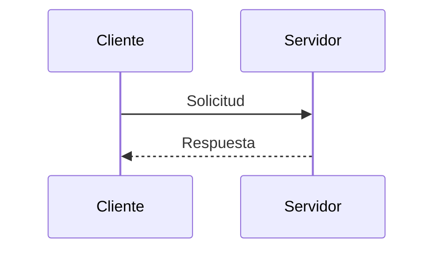

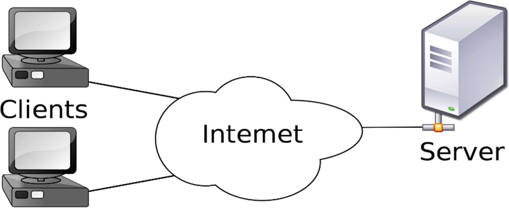

La comunicación entre clientes y servidores web se realiza mediante el protocolo HTTP o su versión segura HTTPS, que tienen los puertos reservados 80 y 443 respectivamente en la lista de puertos bien conocidos.

La arquitectura a tres capas es una ampliación del modelo cliente-servidor. La lógica de aplicación se separa en:

| | Capa | Para qué |
|---|---|---|
| a) | **Capa de presentación** | Para la interfaz de usuario. Muestra información y permite interactuar con el sistema usuario. |
| b) | **Capa de negocio** | Para la lógica propia de la aplicación. Se comunica con las otras dos capas. |
| c) | **Capa de datos** | Para gestionar la base de datos. |

> [!important]
> La capa de presentación no se comunica directamente con la de datos, sino que se hace a través de la capa de negocio.

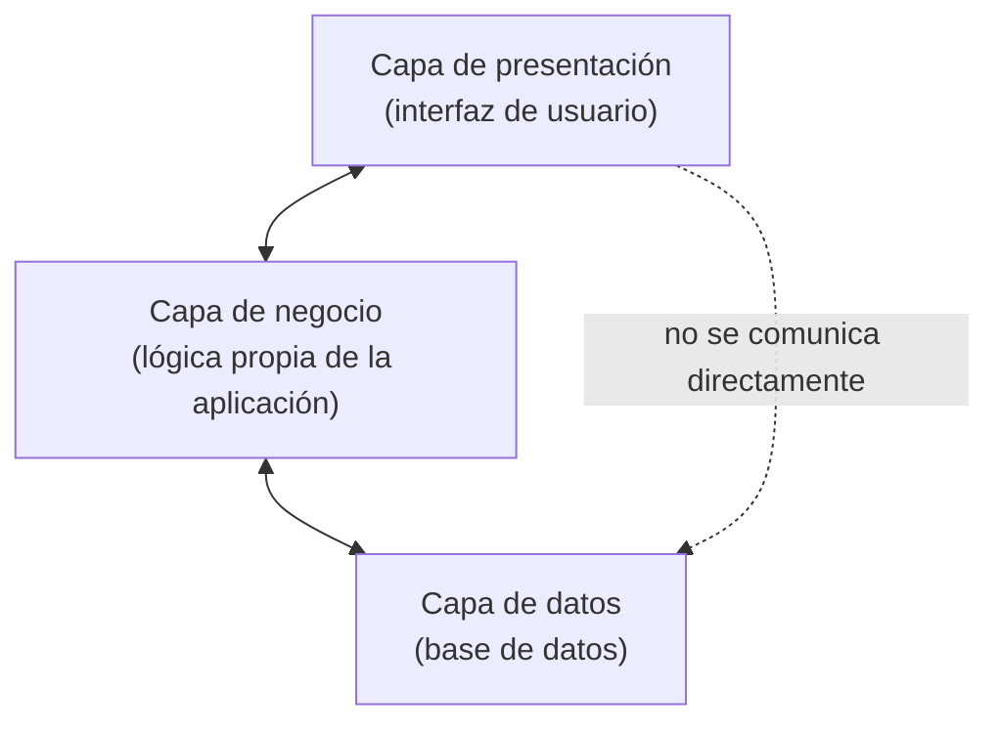

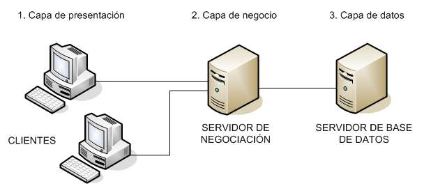

En una aplicación web:

- La capa de presentación se ejecuta en un navegador, en el ordenador del usuario
- La capa de negocio en el servidor web
- La de datos, en el servidor de base de datos.

Cabe señalar que éstas dos últimas pueden estar en el mismo ordenador o en equipos diferentes.

> [!goal] Objetivo
> Desacoplar la lógica de negocio de la presentación para conseguir código más reutilizable. Además, mediante la separación entre componentes se obtienen aplicaciones más fáciles de mantener y ampliar.

Por ejemplo, al hacer login en una aplicación web:

- Desde el cliente (navegador) se envía un formulario → Capa de presentación
- En el servidor (capa de negocio) se consulta con la base de datos (capa de datos) si los datos son correctos.
- En función de la respuesta, se pasan las instrucciones correspondientes a la capa de presentación → se permite el acceso o se muestra un error.

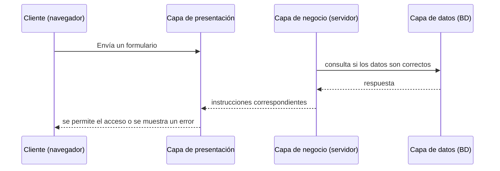

**Responsabilidades de cada una de las capas:**

| Capa | Responsabilidades |
|---|---|
| **Capa de presentación** | comprende las responsabilidades de la presentación, como navegabilidad del sistema, validación de datos de entrada, formateo de los datos de salida, internacionalización, renderizado de presentación, etc |
| **Capa de negocio** | Comprende las responsabilidades de la lógica de negocio (o dominio) del sistema. El resultado del análisis funcional, conjunto de reglas de negocio que abstraen el mundo real. La capa de negocio ha de ser independiente de la capa de presentación y viceversa (en la medida de lo posible) |
| **Capa de persistencia o datos** | Comprende las responsabilidades de lógica de persistencia de las entidades que maneja el sistema en desarrollo: Inserción, Eliminación, Actualizaciones, Búsquedas, etc, no tiene porqué tratarse necesariamente de una base de datos relacional. |

**Definiciones Front-end, Back-end, Full stack**

| Perfil | Definición |
|---|---|
| **Front-end** | Es la parte del desarrollo que se encarga del diseño y maquetación de la aplicación web utilizando tecnologías como HTML, CSS y Javascript (y sus frameworks). En este caso debe preocuparse también de la correcta presentación en cualquier tipo de dispositivo e incluso del posicionamiento en buscadores |
| **Back-end** | Es la parte del desarrollo que se encarga del lado servidor utilizando tecnologías como PHP, JSP y Python. También se encarga de la administración del servidor de aplicaciones y la Base de Datos. |
| **Full stack** | En un perfil que engloba los dos anteriores. En este caso el desarrollador quizás no es un experto de ninguna tecnología concreta, pero tiene amplios conocimientos de todo el conjunto y es capaz de colaborar en cualquiera de las partes. |

### 1.2.- Generación dinámica de páginas web

El lenguaje básico para la web es HTML.

Una página que esté escrita solo en HMTL será → estática. Se mostrará siempre el mismo contenido.

Cuando se utiliza un lenguaje de programación en el servidor se pueden generar páginas en función de la solicitud del cliente → páginas webs dinámicas.

Para ejecutar código en un servidor web hay varias opciones. La más habituales son:

| Opción | Cómo funciona |
|---|---|
| **Common Gateway Interface (CGI)** | Las peticiones de los clientes se pasan a un ejecutable en el servidor. Este programa genera la salida y el servidor se la pasa al cliente. |
| **Como módulo del servidor web** | En lugar de utilizar un programa externo, el propio servidor cuenta con un módulo, generalmente un intérprete, para ejecutar código. |
| **Servlets** | Los servlets de Java son objetos que reciben una petición y devuelven una respuesta en función de la petición. Para utilizar servlets hace falta un contenedor web, que es el que interactúa con ellos. |

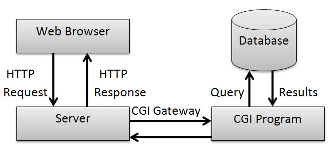

#### 1.2.1.- Lenguajes de programación en entornos servidor. Lenguajes de scripting

Se entiende por lenguaje de scripting o de guiones (o embebido) aquel que se intercala con el código HTML que forma una aplicación web.

> [!note]
> La idea básica es crear una serie de plantillas HTML en las que se insertan instrucciones de programación en diferentes lenguajes que son ejecutadas por un servidor para determinar las partes dinámicas de las páginas web.

Para que estas porciones de código sean ejecutadas, el agente que actúa de servidor (servidor web) debe tener instalado un módulo (scripting engine) que sea capaz de reconocer e interpretar el lenguaje en el que se programa dicho código.

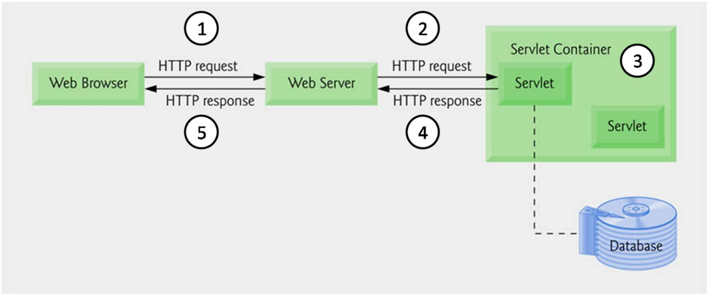

Hay muchos lenguajes para el lado del servidor. Los más habituales son:

| Lenguaje | Descripción |
|---|---|
| **PHP** | Sin duda, el lenguaje más extendido en el lado servidor. |
| **JSP** | La versión Java de PHP. Para utilizarlo hace falta un contenedor web. |
| **ASP.NET** | La alternativa a PHP de Microsoft, integrada en la plataforma .NET |
| **PERL** | Es un lenguaje especialmente pensado para el procesamiento de expresiones regulares. |
| **Ruby** | Es un lenguaje orientado a objetos. |

> [!question] ACTIVIDAD 1.3
> Busca información sobre otros lenguajes del lado del servidor (que no se hayan nombrado en este tema) y explica para qué se recomienda cada uno de ellos.

También hay muchos frameworks para desarrollo de aplicaciones web:

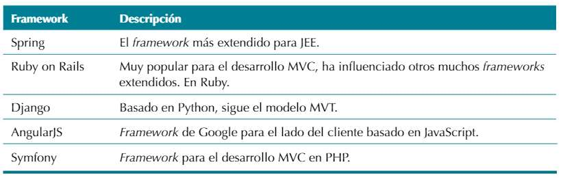

#### 1.2.2.- Integración con los lenguajes de marcas

Las páginas dinámicas se componen de:

- Una parte estática en HTML
- Una parte dinámica en algún lenguaje de programación

Cuando se solicita una página:

1. El servidor busca en ella bloques de código.
   1.1. Si los encuentra los ejecuta y los sustituye por su salida.

> [!tip] En PHP los bloques se delimitan por `<?php` ... `?>`

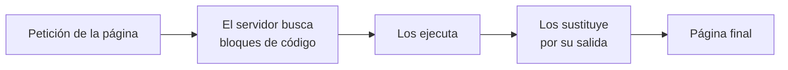

**Ejemplo:**

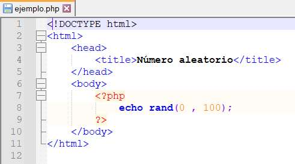

Prueba el código utilizando esta web: https://www.w3schools.com/php/phptryit.asp?filename=tryphp_compiler

**¿Qué ocurre en este código?**

El cliente solicita la página y el servidor ejecuta el bloque y lo sustituye por su salida. En este caso un número aleatorio entre 0 y 100. Imaginemos que la función nos genera el número 8. Entonces el servidor enviaría al cliente el siguiente código estático:

```html
<!DOCTYPE html>
<html>
   <head>
        <title>Número aleatorio</title>
   </head>
   <body>
        8
   </body>
</html>
```

---

## 3.- Páginas web estáticas y dinámicas. Evolución de la Web

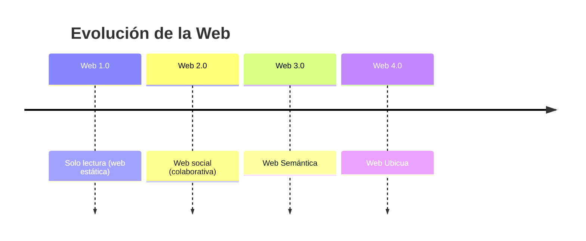

### 3.1.- WEB 1.0

La Web 1.0 empezó en los años 60's junto a Internet, de la forma más básica que existe, con navegadores de solo texto, como ELISA, era bastante rápido pero muy simple. Después en los 90 surgió HTML (Hyper TextMarkup Language) como lenguaje hipertexto e hizo que las páginas Web sean más agradables a la vista y puedan contener componentes como imágenes, formatos y colores. Los primeros navegadores visuales fueron Netscape e Internet Explorer.

Esta Web es de solo lectura WEB ESTÁTICA, ya que el usuario no puede interactuar con el contenido de la página (ningún comentario, respuesta, etc). Estando la información totalmente limitada a lo que el Webmaster (administrador) pueda publicar.

https://www.hazhistoria.net/blog/historia-del-www-de-la-web-10-la-web-30

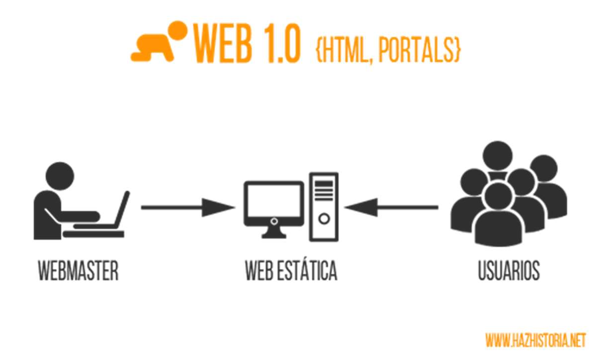

> [!note] Idea clave
> Solo lectura · WEB ESTÁTICA · el usuario no puede interactuar con el contenido.

### 3.2.- WEB 2.0

La Web 2.0 es un concepto que se originó en una sesión de brainstorming entre Dale Dougherty de O'Really y Craig Cline de MediaLive International, quienes estaban preparando una conferencia y decidieron hablar del renacimiento de la Web después de la crisis de los ".com" en 2001. A partir de estas ideas, en una conferencia en octubre de 2004, caracterizan a la Web 2.0 como una nueva actitud o evolución de la Internet, que se resumía en tres principios básicos:

- La web como plataforma.
- La inteligencia colectiva.
- La arquitectura de la participación.

Una segunda generación en la historia del desarrollo de tecnología Web, basada en comunidades de usuarios y en una amplia gama de herramientas, como las redes sociales, blogs o wikis, que fomentan la colaboración y el intercambio de información.

La Web 2.0 es también llamada Web social por el enfoque colaborativo y de construcción social de esta herramienta, donde el usuario es el ente más importante de información.

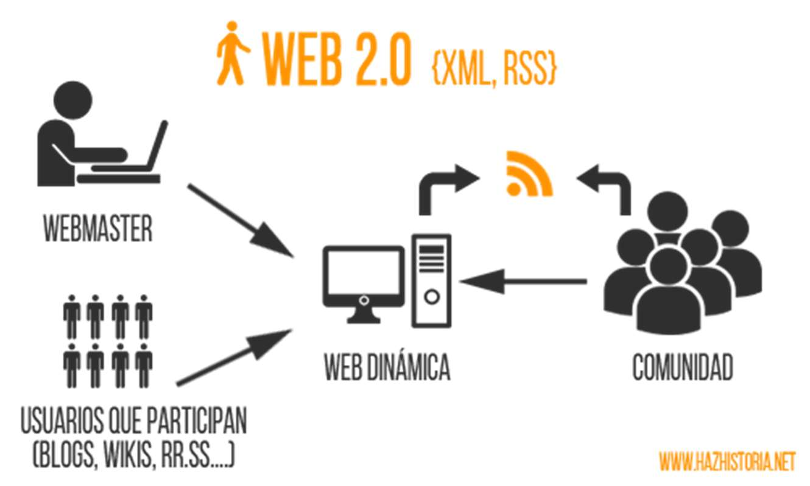

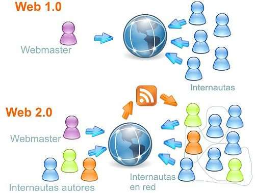

> [!note] Idea clave
> Web social · comunidades de usuarios · el usuario es el ente más importante de información.

### 3.3.- WEB 3.0

La Web 3.0 es considerada también como una extensión de Web Semántica definida por el premio Nobel Sir Timothy "Tim" John Berners – Lee. Y trata de poder enriquecer la comunicación mediante metadatos semánticos (ontologías) que aportan un valor añadido a la información, la diferencian y la hacen más inteligente. Por lo que los contenidos ahora ya no son tratados por su sintáctica sino por su semántica.

Una posible definición de Web 3.0 sería la siguiente: Aquellas plataformas o herramientas online que no sólo permiten la conversación e interacción entre sus usuarios, sino que además son capaces de actuar de forma proactiva.

La Web 3.0 usa Internet para conectar información. Hace la Web más inteligente, teniendo en cuenta nuestros gustos, preferencias, hábitos e incluso el contexto. Páginas capaces de comunicarse con otras páginas mediante el lenguaje natural, dando lugar a esa llamada Web Semántica. ¿Inteligencia artificial? ¿Software capaz de comprender el lenguaje humano? La respuesta es sí, todo eso y seguramente mucho más. En definitiva y una vez más, la tecnología al servicio del bienestar y del acceso a la información. Los primeros ejemplos de Web 3.0 que podemos encontrar actualmente están orientados a nuevas funcionalidades en buscadores.

En la web 3.0 los dispositivos están conectados en una red descentralizada en lugar de depender de servidores basados en bases de datos. La nueva internet está centrada en el usuario, es más segura, privada y mejor conectada.

La Web 3.0 es una red más transparente y justa donde todos puedan participar sin temer una pérdida de privacidad y seguridad. El cambio de la Web 2.0 a la 3.0 es evidente con la evolución de la tecnología que nos rodea. Tecnologías como la inteligencia artificial, el big data y otros harán que sea más fácil proporcionar una experiencia web más personal que nunca. Además, las aplicaciones web serán más intuitivas y serán más accesibles para que las personas las utilicen en sus vidas diarias.

Más sobre web 3.0 https://101blockchains.com/es/web-3-0/

También empieza a surgir el concepto de web 3D, tras la moda surgida del cine. Queda mucho camino por recorrer, pero ya en CSS3 podemos crear transformaciones que utilizan la tercera dimensión y el HTML5 comienza a incorporar avances en este sentido. De manera más avanzada se está creando WebGL, una especificación estándar para mostrar gráficos 3D acelerados por hardware en páginas web.

Podemos ver una demo del mítico Quake 3 (http://media.tojicode.com/q3bsp/)

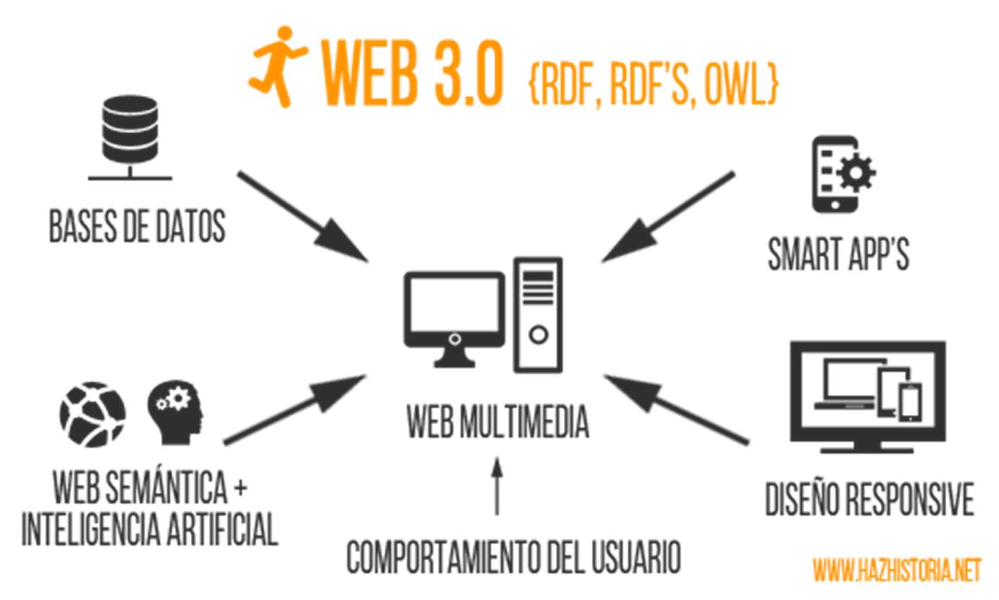

> [!note] Idea clave
> Web Semántica · metadatos semánticos (ontologías) · se trata por semántica, no por sintáctica.

### 3.4.- WEB 4.0

La Web 4.0 es un término que se va acuñando recientemente y trata de movernos hacia una Web Ubicua donde el objetivo primordial será el de unir las inteligencias, para que tanto las personas como las cosas se comuniquen entre sí para generar la toma de decisiones.

Se trata de una web activa. Por ejemplo, hasta la fecha, el uso de buscadores es algo importante, ya que brindan información (páginas web) sobre lo que un usuario busca o escribe. Sin embargo, la web 4.0 será mucho más activa y funcionará como un asistente virtual con inteligencia artificial. Una persona puede decir "quiero una reservación en un hotel en el centro de Lima para el 15 de agosto". Entonces, el asistente entenderá el lenguaje y directamente reservará lo solicitado, basándose en reservas previas, gustos, presupuestos comunes u otros factores propios del usuario. Por otro lado, la web también se volverá mucho más interactiva. Puede reservar una entrada al cine para el estreno de la película favorita de un consumidor y solo necesitará su confirmación para hacer los pagos respectivos. ¿Cómo es posible lograrlo? La gran cantidad de información gracias al big data, el aprendizaje automático y la mejora de asistentes actuales como Cortana o Siri permitirán una máxima personalización y optimización de tareas.

> [!note] Idea clave
> Web Ubicua · unir las inteligencias · asistente virtual con inteligencia artificial.

> [!summary] RESUMEN: La evolución puede resumirse en
> - **Web 1.0** - Personas conectándose a la Web y la Web como punto de información estática.
> - **Web 2.0** - Personas conectándose a personas, la inteligencia colectiva como centro de información y la Web es sintáctica.
> - **Web 3.0** - Aplicaciones Web conectándose a aplicaciones Web, las personas siguen siendo el centro de la información y la Web es semántica.
> - **Web 4.0** - Personas conectándose con Personas y aplicaciones Web de forma ubicua, se añaden tecnologías como la Inteligencia Artificial, la Voz como vehículo de intercomunicación para formar una Web Total.

---

## 4.- Herramientas para el desarrollo

Esta es una lista de editores de código para sacar el máximo rendimiento a nuestro código PHP.

### 4.1.- Entornos de desarrollo vs editores de código

Existen dos tipos de programas para escribir código, los editores de código y los IDE (Integrated Development Environment o entorno de desarrollo). A continuación, se explican las principales diferencias.

#### 4.1.1.- Editor de código

Es un programa ligero que no exige mucha RAM o procesador, en dónde puedes abrir y crear un archivo a la vez y guardarlo en una carpeta, ¡pero ojo!, el hecho de que sean programas ligeros no quiere decir que sean limitados.

> [!tip]
> A un editor puedes agregarle plugins para realizar muchas más funciones (por ejemplo, que pueda soportar múltiples lenguajes) y hacerlo más potente

#### 4.1.2.- Entornos de desarrollo (IDEs)

Un ambiente de desarrollo integrado, a diferencia de un editor, es un programa más pesado que pide mucha más memoria RAM y un procesador más poderoso, además de que es un espacio para trabajar proyectos completos no solo en archivos.

Contienen herramientas integradas, es decir, ahora ya no crearás carpetas por tu cuenta, pueden tener:

- Un compilador (para los lenguajes compilados),
- Un emulador,
- Control de versiones y terminales.
- Etc…

A continuación, se muestran los más conocidos:

##### 4.1.2.1.- Netbeans

Miles de programadores coinciden en destacar a Netbeans como el mejor IDE para PHP. Tiene un gran número de funciones, es gratuito y tiene soporte para idiomas como el inglés, el japonés, el ruso, el portugués brasileño y el chino simplificado. La versión gratuita de NetBeans data del año 2010, después de que Sun Microsystems, la lanzara en código abierto. Cuenta con una de las mayores comunidades de desarrolladores que trabajan en un entorno de desarrollo integrado de código abierto. Cabe destacar que se puede utilizar con frameworks como Zend, Doctrine, Smarty y Symfony2. Algunas de las características principales son las plantillas de código, el autocompletado inteligente, sugerencias, arreglos rápidos y refactorización.

##### 4.1.2.2.- PHPStorm

Si no es considerado el número 1 de la lista es principalmente porque muchas de sus utilidades son de pago.

La versión gratuita, aun así, es una herramienta con enorme potencial. Desarrollado por JetBrains, PHPStorm funciona muy bien con los principales frameworks (Symfony, Zend Framework, Yii, CakePHP, Laravel) y con los principales sistemas CMS como Drupal, Magento y Wordpress. Pero no solo destaca en la parte back. Este IDE ofrece edición en directo con tecnologías como CSS, HTML5, JavaScript o TypeScript. La popularidad de PHPStorm se puede medir por el hecho de que grandes marcas como Expedia, Yahoo, Cisco, Salesforce y wikipedia también utilizan PHPStorm como su editor de código.

##### 4.1.2.3.- Eclipse

Eclipse PDT (PHP Development Tools) es otra de las opciones open source con mayor recorrido y fiabilidad. Posee una enorme comunidad de desarrolladores que trabajan en todo tipo de plugins necesarios para poner a Eclipse a la altura de otros IDE de primera clase como PHPStorms, NetBeans y Zend studio. La configuración inicial no es sencilla, por lo que habrá que dedicarle tiempo para configurarlo al gusto de cada usuario. Como aspecto negativo, hay que destacar que algunos desarrolladores se quejan de que es lento. Sin embargo, esto ha dejado de ser un problema, ya que los ordenadores con los que se trabaja en estos días son suficientemente potentes como para no notar diferencia de rendimiento con otros IDE's. Algunas de las características clave incluyen el resaltado de sintaxis, ayuda de código, formateador de código, refactorización, plantillas de código, navegación de código, depuración de PHP, validación de sintaxis, además de la gran comunidad de usuarios.

##### 4.1.2.4.- Sublime Text 3

Un editor todoterreno que no debe faltar en el disco duro del ordenador de un programador es Sublime Text 3. Este editor soporta una enorme cantidad de lenguajes y tiene gran capacidad de adaptación a cada uno de ellos. Es ligero, cuenta con multitud de funciones y es compatible con Windows, OSX y Linux. Su principal poder reside en la potencia de sus plugins y paquetes. Actualmente cuenta con muchos paquetes de PHP disponibles que ayudan a transformar este elegante editor en un gran Sublime PHP IDE. Algunos de los paquetes más útiles y notables para este propósito incluyen el control de paquetes, el cliente xDebug, el CodeBug, PHPCS, CodIntel, Simple PHPUnit y PHPDoc. Una vez configurado para PHP, Sublime Text 3 no tiene nada que envidiar a editores incluso con versiones de pago.

---

## 5.- Servidores Web

Hasta ahora hemos comentado que para el desarrollo de aplicaciones web en entornos cliente/servidor pueden utilizarse diferentes modelos, tecnologías y lenguajes. En cualquier caso, en muchas ocasiones, la posibilidad de responder a una petición hecha por un cliente depende de las capacidades que tenga el servidor web y los módulos o extensiones que tenga instalados.

El cometido principal de un servidor web, es servir páginas web, es decir proveer de contenido estático a un cliente que ha realizado una petición a través de un navegador. Para ello, carga un archivo y lo sirve a través de la Red al navegador del solicitante. Este es el funcionamiento habitual cuando lo que se implementa en el servidor es una aplicación web estática (HTML) o dinámica (DHTML), es decir, que el servidor se convierte en un instrumento que proporciona un lugar para guardar y administrar los recursos HTML, que pueden ser accesibles por los usuarios de la Red a través de navegadores.

Para que el servidor pueda entender la petición del cliente, éste tiene que realizar una petición "formal". Es decir, la petición tiene que constar de unos elementos concretos y especificados en un orden determinado.

> [!note]
> Las direcciones de las peticiones suelen ser de tipo URL (Localizador Uniforme de Recurso), que contiene una dirección, la referencia a un cierto protocolo (HTTP, FTP, etc.) y la descripción de un recurso concreto en forma de ruta al objeto que queremos descargar.

Opcionalmente podemos incluir un campo adicional (puerto) indicando el número de puerto por el que el servidor está escuchando las peticiones del cliente.

Con respecto a las peticiones de los clientes es importante destacar que existen distintos modos o métodos para intercambiar información entre cliente y servidor y que deberemos tenerlo en cuenta en el desarrollo de aplicaciones web en el entorno del servidor. Los más comunes:

| Método | Uso |
|---|---|
| **GET** | es un método de invocación en el que el cliente le solicita al servidor web que le devuelva la información identificada en la propia URL. Lo más común es que las peticiones se refieran a un documento HTML o a una imagen, aunque también se puede referir a un programa de base de datos. En tal caso, el servidor ejecuta ese programa y le devuelve al cliente el resultado generado tras esa petición. |
| **POST** | mientras que el método GET se utiliza para recuperar información, el método POST se usa habitualmente para enviar información a un servidor web. Estos casos suelen darse al enviar el contenido de un formulario de autenticación, así como entradas de datos o especificar parámetros para algún tipo de componente ejecutado en el servidor. |
---

## 7.- Glosario de términos

| Término | Definición |
|---|---|
| **Aplicación Web** | Aplicación informática a la que se accede mediante una interfaz web utilizando un navegador. |
| **Cliente** | En el modelo cliente-servidor, los clientes solicitan funcionalidad a los servidores. |
| **Framework** | Un framework es una plataforma para el desarrollo de aplicaciones. Puede incluir librerías y metodologías. |
| **HTML** | Hyper Text Markup Language, el lenguaje básico para la creación de páginas web. Es un estándar del W3C. |
| **HTTP** | Hyper Text Transfer Protocol, protocol de transferencia de hipertexto. Es el protocolo que utilizan clientes y servidores web para comunicarse. Es un estándar del W3C. |
| **HTTPS** | Versión segura del HTTP. |
| **IDE** | Integrated Development Enviroment, entorno de Desarrollo integrado. Programa que integra herramientas útiles para programar, como editores, compiladores o control de versiones. |
| **Protocolo** | Según la RAE, conjunto de reglas que se establecen en el proceso de comunicación entre dos sistemas. |
| **Servidor** | En el modelo cliente-servidor, los servidores proveen servicios a los clientes. |
| **W3C** | World Wide Web Consortium, organism que elabora y mantiene varios de los estándares más importantes en Internet, como el HTTP o el HTML. |

---

