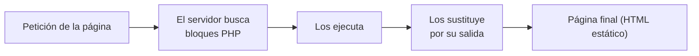

# 🐘 UT2.- LENGUAJE PHP. INSERCIÓN DE CÓDIGO EN PÁGINAS WEB

**Desarrollo web en entorno servidor (2ºDAW)**

> [!abstract] Resultados de aprendizaje
> **2.** Escribe sentencias ejecutables por un servidor Web reconociendo y aplicando procedimientos de integración del código en lenguajes de marcas.
>
> **Criterios de evaluación:** mecanismos de generación de páginas Web con código embebido · tecnologías asociadas · etiquetas para incluir código en el lenguaje de marcas · sintaxis del lenguaje · sentencias simples y sus efectos en el documento resultante · directivas para modificar el comportamiento predeterminado · tipos de variables y operadores · ámbitos de las variables · diseño de aplicaciones web sencillas.

> [!info] Índice de contenido
> 1. Estructura de los contenidos
> 2. PHP y HTML. Código incrustado
>     - 2.1. Cómo ejecutar el código para visualizarlo en el navegador
>     - 2.2. Sintaxis de PHP
>     - 2.3. Variables y tipos de dato
>         - 2.3.1. Declaración de variables
>         - 2.3.2. Asignación por copia y por referencia
>         - 2.3.3. Variables no inicializadas
>         - 2.3.4. Constantes
>         - 2.3.5. Tipos de datos escalares
>         - 2.3.6. Ámbito de las variables
>         - 2.3.7. Variables predefinidas
>     - 2.4. Comentarios
>     - 2.5. Expresiones y operadores en PHP
>     - 2.6. Funciones nativas de PHP
> 3. Glosario de términos
> 4. Anexos – Ampliación de funciones nativas PHP
> 5. Referencias bibliográficas

---

## 1.- Estructura de los contenidos

En este tema de introducción al lenguaje PHP, conoceremos la sintaxis básica, entenderemos cómo se integran PHP y HTML, además de describir los tipos de datos existentes y conocer algunas de las funciones más usadas en este lenguaje.

> [!note]
> Para ejecutar un programa en PHP necesitamos guardarlo dentro de un servidor web.

---

## 2.- PHP y HTML. Código incrustado

PHP (acrónimo recursivo de **P**HP: **H**ypertext **P**reprocessor) es un lenguaje de programación para desarrollo web en el lado servidor. Desde su aparición en 1994 ha tenido gran aceptación y se puede decir que es uno de los lenguajes más utilizados.

- El lenguaje PHP es flexible y permite programar pequeños *scripts* con rapidez.
- Comparado con lenguajes como Java, requiere escribir menos código y, en general, resulta menos engorroso.
- Las páginas de PHP contienen HTML con código incrustado que hace "algo".

El código de PHP está encerrado entre las etiquetas especiales de comienzo y final `<?php` y `?>` que permiten entrar y salir del "modo PHP".

**Ejemplo: `hola_mundo.php`**

Página HTML completa con un bloque PHP incrustado (líneas 7-9). El bloque tiene una única sentencia que sirve para mostrar la cadena "Hola mundo":

```html
<!DOCTYPE html>
<html lang="es">
    <head>
        <meta charset="UTF-8">
        <title>Hola mundo</title>
    </head>
    <body>
        <?php
        echo "Hola mundo";
        ?>
    </body>
</html>
```

Al solicitar la página al servidor web, se observa que el servidor web ha modificado una parte del fichero: **el bloque PHP ha desaparecido y en su lugar aparece "Hola Mundo"**.

> [!important]
> El servidor web procesa los bloques de PHP y los sustituye por su salida, es decir, por lo que muestran las sentencias del bloque. Si se consulta el código fuente de la página (pulsando **Ctrl + U**), solo se ve HTML: el código PHP nunca llega al navegador.

En este caso se utiliza la palabra reservada **`echo`**, que muestra el valor de una variable o de una cadena de texto.



> [!tip]
> Cuando un fichero contiene solo PHP se recomienda **no cerrar la etiqueta del último bloque**. Puede dar problemas si la respuesta del servidor involucra varios ficheros.
> Referencia: https://www.php.net/manual/es/language.basic-syntax.instruction-separation.php

### 2.1.- Cómo ejecutar el código para visualizarlo en el navegador

Para probar el programa lo hacemos de dos formas:

**1) Directamente en el servidor web (Apache)**

- Creando la página dentro de la carpeta `c:/xampp/htdocs/` e iniciando el servidor Apache del XAMPP.
- Por ejemplo, creamos `hola.php` con el código anterior; para probar la ejecución pondremos `http://localhost/hola.php` en el navegador.

**2) Utilizando NetBeans**

1. Creamos un proyecto nuevo: menú **File → New Project**, se selecciona **PHP → PHP Application** y se pulsa *Next*.
2. Se añade el nombre del proyecto, la ubicación y se elige la codificación (en el ejemplo, dentro de la carpeta de XAMPP: `c:/xampp/htdocs/proyecto1`).
3. En el siguiente paso se configura desde dónde se va a ejecutar:
   - **Apache de XAMPP:** el proyecto debe estar en `c:/xampp/htdocs/` y la URL del proyecto es `http://localhost/proyecto1` (el nombre de la carpeta donde está lo que se va a ejecutar).
   - **Servidor PHP de NetBeans:** da igual la ubicación del proyecto; se ejecuta en la URL `http://localhost:8000`. El proyecto se ejecutará en el *hostname* que digamos y el puerto que elijamos.

> [!note]
> Por defecto, NetBeans nos crea el proyecto con un `index.php` (o no).
> Todos los proyectos deberán tener un `index.php`, que es la página que se inicia por defecto al poner el nombre de la URL del proyecto en el navegador: `http://localhost/proyecto1/`
> Si las páginas tienen otro nombre, para que se ejecuten pondremos `http://localhost/proyecto1/nombrepagina.php`

### 2.2.- Sintaxis de PHP

El elemento básico en PHP es el **bloque**. Un bloque PHP está delimitado por las etiquetas correspondientes y contiene una serie de **sentencias separadas por punto y coma**.

### 2.3.- Variables y tipos de dato

Una de las características principales de PHP es que es un lenguaje **no fuertemente tipado**: no es necesario indicar el tipo de dato al declarar una variable.

De hecho, las variables no se declaran, **se crean la primera vez que se les asigna un valor**. El tipo de dato depende del valor con que se inicialicen.

Esto agiliza la escritura de programas, pero también tiene inconvenientes: si no se presta atención, puede dar lugar a código de baja calidad y, a medida que las aplicaciones crecen, pueden darse errores difíciles de depurar.

- Manual: https://www.php.net/manual/es/language.variables.php

#### 2.3.1.- Declaración de variables

En PHP los identificadores de las variables van siempre precedidos por el carácter **`$`**.

El identificador de la variable debe comenzar por:

- Una letra
- Un guión bajo (`_`)

Dicho identificador puede estar formado por números, letras y guiones bajos.

Para declarar una variable, sólo hay que asignarle un valor:

```php
$nombre = valor;
```

Por ejemplo, esta sentencia declara la variable `$entero`, que será de tipo `integer` porque se inicializa con un entero:

```php
$entero = 4;
```

También es posible cambiar el tipo de dato de una variable simplemente asignándole un valor de otro tipo de dato.

#### 2.3.2.- Asignación por copia y por referencia

En principio, la asignación de variables se realiza mediante **copia**. Si hacemos:

```php
$a = $b;
```

Se crea una nueva variable `$a` y se le asigna el valor que tenga `$b`. Las variables `$a` y `$b` representan **posiciones diferentes de memoria**, aunque tengan el mismo valor después de la asignación.

También es posible definir una **referencia** a una variable utilizando el operador ampersand (`&`):

```php
$var2 = &$var1;
```

En este caso `$var2` no es una nueva variable con el valor de `$var1`. Por el contrario, `$var2` apunta a la **misma dirección de memoria** que `$var1`, de manera que `$var1` y `$var2` son en realidad dos nombres para el mismo dato.

- Manual: https://www.php.net/manual/es/language.operators.assignment.php

#### 2.3.3.- Variables no inicializadas

> [!warning]
> Si una variable no inicializada aparece dentro de una expresión, ésta se calcula tomando el **valor por defecto** para ese tipo de dato.

Si se intenta utilizar una variable antes de asignarle un valor, se genera un error de tipo **`E_NOTICE`**, pero **no se interrumpe la ejecución** del script.

- Manual: https://www.php.net/manual/es/language.variables.basics.php

#### 2.3.4.- Constantes

Para definir constantes se utiliza la función **`define()`**, que recibe el nombre de la constante y el valor que queremos darle:

```php
define("LIMITE", 1000);
```

> [!tip]
> Es habitual utilizar identificadores en **mayúscula** para las constantes.

- Manual: https://www.php.net/manual/es/language.constants.php

#### 2.3.5.- Tipos de datos escalares

PHP ofrece **cuatro tipos de datos escalares**:

| Tipo | Descripción |
|---|---|
| **integer** | Números enteros |
| **float** | Números reales (decimales) |
| **boolean** | Verdadero o falso |
| **string** | Cadenas de caracteres |

##### A) Números

Para representar números enteros se usa el tipo de dato `integer`. El tamaño y los valores máximo y mínimo de un entero dependen de la plataforma, y se pueden conocer mediante las constantes:

- `PHP_INT_SIZE`
- `PHP_INT_MAX`
- `PHP_INT_MIN`

Para números reales, se utiliza el tipo `float`. Suele ofrecer una **precisión de 14 decimales** (aunque dependerá de la plataforma).

> [!note]
> La conversión entre `integer` y `float` es **automática**. También se pueden utilizar los operadores de conversión `(int)` o `(float)`.

- Manual: https://www.php.net/manual/es/language.types.intro.php

##### B) Cadenas

El tipo de dato `string` permite almacenar cadenas de caracteres. Para delimitar una cadena es posible utilizar comillas simples o dobles, pero hay una diferencia:

- Si se utilizan **comillas dobles** (también llamadas *comillas mágicas*), las variables que aparezcan dentro de la cadena **se sustituirán por su valor**.

```php
$nombre = "Mundo";
echo "Hola $nombre";   // Hola Mundo
```

##### C) Booleanos

Este tipo de datos es para variables booleanas. Solo pueden tomar valores **`TRUE`** o **`FALSE`**.

Es el tipo de dato que se obtiene, entre otros casos, como resultado de los operadores de comparación y se utiliza en sentencias condicionales y bucles.

Cuando se espera un valor booleano y se recibe otro tipo de dato, se aplican las reglas de conversión recogidas en el cuadro siguiente:

| Tipo | Valor como boolean |
|---|---|
| `integer` | Si es `0` se toma `FALSE`, en otro caso `TRUE` |
| `float` | Si es `0.0` se toma `FALSE`, en otro caso `TRUE` |
| `string` | Si es una cadena vacía o `"0"`, se toma como `FALSE`, en otro caso `TRUE` |
| Variables no inicializadas | `FALSE` |
| `null` | `FALSE` |
| `array` | Si no tiene elementos se toma `FALSE`, en otro caso `TRUE` |

##### D) Otros tipos de dato (tipos compuestos y especiales)

Además de los tipos de datos escalares, en PHP también existen los siguientes tipos de datos:

| Tipo | Descripción |
|---|---|
| **array** | Para representar colecciones de elementos. |
| **object** | PHP tiene soporte completo para la programación orientada a objetos. |
| **callable** | Un tipo de dato especial para representar funciones de *callback*, funciones que se pasan a otras funciones. |
| **null** | Representa una variable que no ha sido asignada. Solo puede tomar un único valor, `NULL`. Se considera que una variable es de tipo `null` si se le asigna el valor `NULL` o no está inicializada. |
| **resource** | Representa recursos externos, como una conexión a una base de datos. |

#### 2.3.6.- Ámbito de las variables

El **ámbito** de una variable es la parte de código en que ésta es visible.

- Una variable declarada en un fichero PHP está disponible en ese fichero y en los ficheros que se incluyan desde este.
- Las funciones definen un **ámbito local**: las variables que se declaran en las mismas solo son accesibles desde la propia función. Además, desde la función no se puede acceder a otras variables que no sean las locales o sus argumentos.
- Para definir **variables globales** hay dos opciones:
    - La palabra reservada `global`
    - La variable predefinida `$_GLOBALS`

- Manual: https://www.php.net/manual/es/language.variables.scope.php

#### 2.3.7.- Variables predefinidas

En PHP hay muchas variables predefinidas disponibles. Contienen información sobre el servidor, datos enviados por el cliente o variables de entorno.

Dentro de las variables predefinidas hay un grupo de ellas, las **superglobales**, que están disponibles **en cualquier ámbito**. Cada una de ellas guarda información de un tipo.

Por ejemplo, en `$_SERVER` hay información sobre el servidor en el que está alojada la página. El script siguiente muestra algunos de los datos disponibles:

```php
<?php
echo "<pre>";
print_r($_SERVER);
echo "</pre>";
?>
```

> [!important]
> Las variables superglobales son muy relevantes para el desarrollo de aplicaciones web y se irán poniendo en práctica a lo largo del curso.

- Manual: https://www.php.net/manual/es/language.variables.superglobals.php

---

### 2.4.- Comentarios

En PHP se pueden utilizar comentarios:

- **De bloque**, encerrados entre `/*` y `*/`
- **De línea**, comenzando por `//` o por `#`

```php
/* Este es un
   comentario de bloque */

echo "Hola"; // comentario de línea
echo "Adiós"; # también vale con almohadilla
```

> [!tip]
> Como cualquier lenguaje, comentar adecuadamente el código se considera una buena práctica de programación.

- Manual: https://www.php.net/manual/es/language.basic-syntax.comments.php

---

### 2.5.- Expresiones y operadores en PHP

#### 2.5.1.- Expresiones

Las expresiones son los bloques de construcción más importantes de PHP. En PHP casi todo lo que se escribe es una expresión. La manera más simple y acertada de definir lo que es una expresión es **«cualquier cosa que tiene un valor»**.

Las formas más básicas de expresiones son las **constantes** y las **variables**.

- Ejemplo: al escribir `$a = 5` se está asignando `5` a `$a`. `5` tiene el valor 5, es decir, `5` es una expresión con el valor 5 (en este caso, una constante entera).
- Después de esta asignación, se espera que el valor de `$a` sea 5 también, por lo que si se escribe `$b = $a`, se espera que esto se comporte tal como si se escribiera `$b = 5`. En otras palabras, `$a` es también una expresión con el valor 5.
- Un ejemplo de expresiones algo más complejo son las funciones.

- Manual: https://www.php.net/manual/es/language.expressions.php

#### 2.5.2.- Operadores

PHP cuenta con los operadores habituales para operaciones aritméticas, lógicas, de manipulación de cadenas y demás.

##### Operador de asignación

- **`=`** — Lo utilizamos para asignar un valor a una variable.

##### Operadores aritméticos

Nos permiten realizar operaciones numéricas con nuestras variables:

| Operador | Nombre | Ejemplo |
|---|---|---|
| `+` | Suma | `$suma = $a + $b;` |
| `-` | Resta | `$resta = $a - $b;` |
| `*` | Multiplicación | `$mul = $a * $b;` |
| `/` | División | `$divi = $a / $b;` |
| `%` | Módulo (resto de la división) | `$resto = $a % $b;` |
| `**` | Exponenciación (`2 ** 3`, elevar 2 a la tercera potencia) | `$expo = $a ** 3;` |

##### Operadores de asignación con una operación asociada

Permiten realizar una operación y una asignación en un único paso:

| Operador | Ejemplo | Descripción |
|---|---|---|
| `+=` | `$suma += 5;` | Suma y asignación |
| `-=` | `$resta -= 10;` | Resta y asignación |
| `*=` | `$fact *= $a;` | Multiplicación y asignación |
| `/=` | `$divi /= 10;` | División y asignación |
| `%=` | `$resul %= $b;` | Módulo y asignación |
| `.=` | `$cadena .= "concateno";` | Concatenación y asignación |

##### Operadores de comparación

Se utilizan principalmente en las condiciones para comparar dos variables:

| Operador | Descripción |
|---|---|
| `==` | Comprueba si son iguales |
| `!=` | Comprueba si son distintos |
| `===` | Comprueba si son iguales y de exactamente el mismo tipo (**Idéntico**) |
| `!==` | Comprueba si son distintos o de distinto tipo (**No idéntico**) |
| `<>` | Diferente (igual que `!=`) |
| `<` | Menor que |
| `>` | Mayor que |
| `<=` | Menor o igual |
| `>=` | Mayor o igual |
| `<=>` | **Comparador de orden**: `$a <=> $b` devuelve un entero menor que, igual a, o mayor que cero cuando `$a` es respectivamente menor que, igual a, o mayor que `$b`. Disponible a partir de PHP 7. |
| `??` | **Uno o el otro** (PHP 7): devuelve el primer operando de izquierda a derecha que exista y no sea `NULL`; `NULL` si no hay valores definidos y no son `NULL`. Por ejemplo `$a ?? $b ?? $c`. |

> [!important]
> Los operadores **`===`** (Idéntico) y **`!==`** (No idéntico) no están presentes en todos los lenguajes.
> Se diferencia el Idéntico del operador Igual (`==`) en que éste, cuando las expresiones no tienen el mismo tipo de dato, **intenta convertirlas antes de compararlas**.
> El operador Idéntico se usa para comparar dos expresiones y se evalúa como verdadero cuando las dos expresiones tienen **el mismo valor y además el mismo tipo de dato**.

##### Operadores lógicos

Sirven para realizar operaciones lógicas: al final van a devolver un "sí" o un "no". Se usan en combinación con los operadores de comparación cuando la expresión de la condición lo requiere:

| Operador | Descripción |
|---|---|
| `and` | Operación lógica "y": será verdadero si ambos son verdaderos |
| `or` | Operación lógica "o": será verdadero si uno de ellos es verdadero |
| `xor` | Operación lógica "xor": será verdadero si uno de ellos es verdadero, pero no ambos |
| `!` | Negación: si era verdadero pasa a falso y viceversa |
| `&&` | Operación lógica "y" |
| `\|\|` | Operación lógica "o" |

##### Operadores de incremento

Sirven para aumentar o disminuir en una unidad el valor de una variable. Son atajos para hacer una operación típica en los recorridos de bucles:

| Operador | Descripción |
|---|---|
| `++$a` | **Pre-incremento**: primero suma y luego asigna |
| `$a++` | **Post-incremento**: primero asigna y luego suma |
| `--$a` | **Pre-decremento**: primero resta y luego asigna |
| `$a--` | **Post-decremento**: primero asigna y luego resta |

Estos operadores realizan dos cosas: por un lado un incremento/decremento y por otro se devuelven ellos mismos como resultado del operador.

- Cuando tenemos un **pre-incremento o pre-decremento**, primero se realiza el incremento/decremento y luego se devuelve ese valor.
- Con el **post-incremento o post-decremento**, primero se devuelve el valor original y luego se realiza el incremento/decremento.

##### Operadores de cadenas

Cuando trabajamos con cadenas de caracteres tenemos un operador especial: el de la **concatenación**. Sirve para unir una cadena a la otra:

- **`.`** — Concatenación

##### Operadores para arrays

Se utilizan para comparar arrays (en el ejemplo, `$a` y `$b` son arrays):

| Ejemplo | Nombre | Resultado |
|---|---|---|
| `$a + $b` | Unión | Unión de `$a` y `$b`. El operador `+` devuelve el array del lado derecho añadido al array del lado izquierdo; para las claves que existan en ambos arrays, serán utilizados los elementos del array de la izquierda y serán ignorados los elementos correspondientes del array de la derecha |
| `$a == $b` | Igualdad | `TRUE` si `$a` y `$b` tienen las mismas parejas clave/valor |
| `$a === $b` | Identidad | `TRUE` si `$a` y `$b` tienen las mismas parejas clave/valor en el mismo orden y de los mismos tipos |
| `$a != $b` | Desigualdad | `TRUE` si `$a` no es igual a `$b` |
| `$a <> $b` | Desigualdad | `TRUE` si `$a` no es igual a `$b` |
| `$a !== $b` | No-identidad | `TRUE` si `$a` no es idéntica a `$b` |

- Manual: https://www.php.net/manual/es/language.operators.php

#### 2.5.3.- Orden de prioridad

Los operadores lógicos y matemáticos tienen un **orden de prioridad o precedencia**. Este es un esquema general que indica el orden en que deben evaluarse en la mayoría de los lenguajes de programación.

> [!tip]
> Lo aconsejable es que cuando se tenga una expresión con varios operadores y operandos se utilicen los **paréntesis**: así no dará lugar a dudas y no tendrá distintas interpretaciones.

- Manual: https://www.php.net/manual/es/language.operators.precedence.php

---

### 2.6.- Funciones nativas de PHP

En PHP ya existen en memoria funciones que nos permiten realizar distintas operaciones al invocarlas. Entre las más utilizadas están las que se detallan en los **Anexos** (§4): funciones numéricas, de cadenas, de tipos y de fechas.

- Listado de funciones nativas – PHP Manual: https://www.php.net/manual/es/indexes.functions.php

---

## 3.- Glosario de términos

| Término | Definición |
|---|---|
| **Array** | Es un tipo de dato compuesto habitual en los lenguajes de programación. Aunque los detalles varían entre lenguajes, en general, se parecen a vectores o listas ordenadas. |
| **Bucle** | Estructura de programación que permite repetir instrucciones. |
| **Estructura condicional** | Posibilita ejecutar o no una instrucción según se cumpla una condición. |
| **Función** | Conjunto de instrucciones que realiza una tarea concreta. |
| **Librería** | Las funciones relacionadas entre sí se agrupan en librerías o bibliotecas. |
| **Programación orientada a objetos** | Paradigma de programación basado en la idea de objetos, elementos que agrupan variables y funciones. |
| **Script** | Programa sencillo, habitualmente ejecutado por un intérprete en lugar de ser compilado. |
| **Variable** | Posición en la memoria del ordenador identificada por un nombre. La variable almacena datos. Estos datos son el valor de la variable. |

---

## 4.- ANEXOS – Ampliación de funciones nativas PHP

> [!tip]
> En ANEXOS se presentan muchas funciones predefinidas en PHP. Su uso puede facilitaros mucho la resolución de un problema mediante un *script* en PHP.

A continuación, se presentan funciones nativas de PHP que pueden ser de ayuda para programar *scripts* en este lenguaje.

### 4.1.- Numéricas

**`round()`**

Redondea: recibirá como parámetro un número y, si el valor después del punto (o de la coma) es menor a 50, redondeará para abajo; de lo contrario, lo hará un número más. Se pueden añadir número de dígitos de precisión poniendo `round($num, $precision)`.

```php
<?php
$numero = 1.49;
echo round($numero);        // 1
echo round(1.75);           // 2
echo round(3.14159, 2);     // 3.14
?>
```

**`floor()`**

Redondea siempre **para abajo**. Es muy útil a la hora de obtener promedios:

```php
<?php
$decimal = 1.50;
$decimal_redondeado = floor($decimal);
echo $decimal_redondeado;   // 1
?>
```

**`ceil()`**

Si queremos que el redondeo sea siempre **para arriba**:

```php
<?php
$decimal = 1.50;
$decimal_redondeado = ceil($decimal);
echo $decimal_redondeado;   // 2
?>
```

**`rand()`**

Genera un número al azar dentro de un rango desde/hasta. Por ejemplo, si quisiéramos devolver un número desde el 1 al 9 (inclusive):

```php
<?php
$numero_al_azar = rand(1, 9);
echo $numero_al_azar;       // p. ej.: 3
?>
```

Puede devolver cualquiera de los números de los rangos comprendidos.

### 4.2.- Cadenas

> [!note]
> Hay que tener en cuenta que el **primer carácter de una cadena ocupa la posición 0**.

**`strtoupper()`** — Convierte una cadena en mayúscula:

```php
<?php
$palabra = 'Me encantan las arepas venezolanas.';
$palabra_mayuscula = strtoupper($palabra);
echo $palabra_mayuscula;    // ME ENCANTAN LAS AREPAS VENEZOLANAS.
?>
```

**`mb_strtoupper($cadena [, string $encoding])`** — Convierte una cadena en mayúscula; a diferencia de lo anterior, la cadena puede tener tildes.

- El parámetro `encoding` es la codificación de caracteres. Si se omite, se usa la codificación interna (`mb_internal_encoding()`).
- La conversión se lleva a cabo según las propiedades de los caracteres **Unicode** y no se ve afectada por la configuración regional, por lo que puede convertir cualquier carácter con propiedad alfabética, como la `á`.

```php
<?php
$palabra = "Martín Martínez León";
echo mb_strtoupper($palabra);   // MARTÍN MARTÍNEZ LEÓN
echo strtoupper($palabra);      // MARTíN MARTíNEZ LEóN (no convierte los acentos)
?>
```

**`strtolower()`** — Convierte una cadena en minúsculas:

```php
<?php
$palabra = 'No GRITES, habla bajito.';
$palabra_minuscula = strtolower($palabra);
echo $palabra_minuscula;    // no grites, habla bajito.
?>
```

**`mb_strtolower($cadena [, string $encoding])`** — Igual que la anterior pero soportando tildes/caracteres Unicode.

**`ucfirst()`** — Convierte **sólo la primera letra** de una cadena en mayúscula:

```php
<?php
$palabra = 'fernando';
$nombre = ucfirst($palabra);
echo $nombre;               // Fernando
?>
```

Si la primera letra es acentuada, necesitamos extraer el primer carácter y convertirlo a mayúscula (`mb_strtoupper(mb_substr($nombr, 0, 1))`) y luego concatenar con el resto de la cadena (`mb_substr($nombr, 1)`).

**`ucwords()`** — Convierte en mayúscula los **primeros caracteres de cada palabra**:

```php
<?php
$palabra = 'fernando gonzalo gaitan';
$nombre_completo = ucwords($palabra);
echo $nombre_completo;      // Fernando Gonzalo Gaitan
?>
```

**`mb_convert_case(string $str, int $mode [, string $encoding])`** — Realiza una conversión a mayúsculas/minúsculas de acuerdo al modo especificado por `mode`, según las propiedades Unicode (no se ve afectada por configuraciones regionales).

- El modo de conversión puede ser `MB_CASE_UPPER`, `MB_CASE_LOWER` o `MB_CASE_TITLE`.

```php
<?php
$palabra = "Mi nombre es Martín Martín León";
echo mb_convert_case($palabra, MB_CASE_LOWER);
// mi nombre es martín martín león
echo mb_convert_case($palabra, MB_CASE_UPPER);
// MI NOMBRE ES MARTÍN MARTÍN LEÓN
echo mb_convert_case($palabra, MB_CASE_TITLE);
// Mi Nombre Es Martín Martín León
?>
```

**`strlen()`** — Devuelve la cantidad de caracteres que tiene una cadena:

```php
<?php
$cancion = 'De aquel amor de música ligera, nada nos libra, nada más queda';
$cantidad_de_caracteres = strlen($cancion);
echo $cantidad_de_caracteres;   // 64
?>
```

**`mb_strlen(string $str [, string $encoding])`** — Devuelve la cantidad de caracteres de una cadena que contiene caracteres Unicode:

```php
<?php
$palabra = "Martín Martín León";
echo strlen($palabra);      // 21 (cuenta bytes)
echo mb_strlen($palabra);   // 18 (cuenta caracteres)
?>
```

**`substr()`** — Permite seleccionar cuántos caracteres queremos mostrar de una cadena. Recibe tres parámetros: la cadena, a partir de qué carácter queremos que se muestre (empieza desde 0) y el número de caracteres:

```php
<?php
$cancion = 'De aquel amor de música ligera, nada nos libra, nada más queda';
$cancion_cortada = substr($cancion, 0, 11);
echo $cancion_cortada;      // De aquel am
?>
```

Si el inicio es **negativo**, la cadena devuelta empezará en el inicio que pongamos pero contando **desde el final de la cadena**.

**`mb_substr(string $str, int $start [, int $length [, string $encoding]])`** — Lo mismo, pero con caracteres Unicode.

**`mb_internal_encoding([string $encoding])`** — Establece/obtiene la codificación de caracteres interna. Por defecto es **UTF-8**.

**`trim()`** — Una de las funciones más usadas de PHP: corta los espacios en las cadenas tanto al principio como al final:

```php
<?php
$cadena = ' Hola ';
$cadena_cortada = trim($cadena);
echo strlen($cadena);           // 6
echo strlen($cadena_cortada);   // 4
?>
```

`trim()` no sólo funciona para eliminar espacios: puede eliminar cualquier tipo de carácter si le agregamos un segundo parámetro:

```php
<?php
$cadena = '///Hola///';
$cadena_cortada = trim($cadena, '/');
echo $cadena_cortada;       // Hola
?>
```

Los otros caracteres predefinidos pueden ser estos:

- `"\0"` — NULL
- `"\t"` — tab
- `"\n"` — new line
- `"\x0B"` — vertical tab
- `"\r"` — carriage return
- `" "` — ordinary white space

- https://www.php.net/manual/es/function.trim.php

**`ltrim($cadena)`** — Elimina espacios en blanco u otros caracteres predefinidos del **lado izquierdo** de una cadena.

**`rtrim($cadena)`** — Elimina espacios en blanco u otros caracteres predefinidos del **lado derecho** de una cadena.

**`substr_count($cadena, $cadenaabuscar)`** — Cuenta el número de apariciones de la cadena que escribimos en *cadena a buscar*. Muy útil para saber si una cadena está contenida en otra:

```php
<?php
$text = 'This is a test';
echo strlen($text);             // 14
echo substr_count($text, 'is'); // cuenta 2
?>
```

**`str_replace()`** — Busca una cadena específica y la reemplaza por otra:

```
str_replace(buscar, reemplazar, lacadena, count)
```

- `buscar` — Especifica el valor a encontrar
- `reemplazar` — Especifica el valor para reemplazar el valor en *buscar*
- `cadena` — Especifica la cadena que se buscará
- `contar` — Una variable que cuenta el número de reemplazos (*opcional*)

```php
<?php
$frase = 'Marge_creo_que_odio_a_Mickael_Jackson.';
$frase_modificada = str_replace('_', '-', $frase, $c);
echo $frase_modificada;   // Marge-creo-que-odio-a-Mickael-Jackson.
echo $c;                  // 6 (cambios)
?>
```

Se pueden modificar cadenas completas, no sólo un carácter:

```php
<?php
$frase = 'Una manzana y una manzana son dos manzanas';
$frase_modificada = str_replace('manzana', 'naranja', $frase);
echo $frase_modificada;   // Una naranja y una naranja son dos naranjas
?>
```

**`strtr($cadena, $from, $to)`** — Convierte caracteres o reemplaza *substrings*.

Si se dan tres argumentos, devuelve una copia de la cadena donde todas las apariciones de cada carácter en `from` han sido convertidas al carácter correspondiente en `to` (`$from[$n]` → `$to[$n]`). Si `from` y `to` tienen distinta longitud, se ignoran los caracteres extra del *string* más largo.

```php
<?php
$cadena = "Martín áé Martín úí León";
echo strtr($cadena, 'aet', 'AET');
// MArTín áé MArTín úí León
?>
```

- https://www.php.net/manual/es/function.strtr.php

**`strstr()`** — Encuentra la primera aparición de un *string*:

```
strstr(string $cadena1, string $cadena2) : string
```

Devuelve parte del *string* `cadena1` iniciando desde, e incluyendo, la primera aparición de `cadena2` hasta el final de `cadena1`.

> [!warning]
> Esta función es **sensible a mayúsculas**.

```php
<?php
$cadena1 = "Probando a buscar una cadena en otra cadena";
$cadena2 = "en otra";
$resultado = strstr($cadena1, $cadena2);
echo $resultado;            // en otra cadena
if (strstr($cadena1, $cadena2)) {
    echo $cadena2 . " Contenida en: " . $cadena1;
}
?>
```

- https://www.php.net/manual/es/function.strstr.php

**`strpos()`, `stripos()` y `strstr()`** sirven para encontrar subcadenas:

- **`strpos`** — Encuentra la **posición** de la primera ocurrencia de un *substring* en un *string*.
- **`stripos`** — Igual que `strpos`, pero **sin considerar mayúsculas ni minúsculas**.

```php
<?php
$mystring = 'abc';
$findme = 'a';
$pos = strpos($mystring, $findme);

// Nótese el uso de ===, puesto que == simple no funcionará como se espera
// porque la posición de 'a' está en el 1° (primer) carácter.
if ($pos === false) {
    echo "La cadena '$findme' no fue encontrada en la cadena '$mystring'";
} else {
    echo "La cadena '$findme' fue encontrada en la cadena '$mystring'";
    echo " y existe en la posición $pos";
}
?>
```

- https://www.php.net/manual/es/function.strpos.php

**`str_contains`** — Determina si una cadena contiene una subcadena dada (**PHP 8**):

```php
<?php
$string = 'The lazy fox jumped over the fence';

if (str_contains($string, 'lazy')) {
    echo "The string 'lazy' was found in the string\n";
}

if (str_contains($string, 'Lazy')) {
    echo 'The string "Lazy" was found in the string';
} else {
    echo '"Lazy" was not found because the case does not match';
}
?>
```

**`var_dump()`** — Muy útil en tiempo de desarrollo a la hora de testear datos, ya sea de una variable o de lo que devuelve una función. Devuelve la **estructura** de una variable cualquiera (tipo y valor):

```php
<?php
$cadena = 'Manzana';
$numero = 5;
$valor_logico = true;
$coleccion = array('Azul', 'Rojo', 'Verde');
echo '<pre>';
var_dump($cadena);
var_dump($numero);
var_dump($valor_logico);
var_dump($coleccion);
echo '</pre>';
?>
```

**`print_r()`** — Muestra información sobre una variable de una manera que sea **legible por humanos**. Similar a `var_dump`.

```php
<?php
echo '<pre>';
print_r($coleccion);
echo '</pre>';
?>
```

### 4.3.- De tipos

> [!note]
> El `false` o `null` no muestra nada a la hora de visualizar. Otro valor en una variable visualiza `1`, que es `true`.

**Funciones para convertir variables a otros tipos:**

| Función | Descripción |
|---|---|
| `boolval()` | Obtiene el valor booleano de una variable |
| `intval()` | Obtiene el valor entero de una variable |
| `floatval()` | Obtiene el valor flotante de una variable |
| `strval()` | Obtiene el valor de cadena de una variable |
| `settype()` | Establece el tipo de una variable |

```php
<?php
$v = boolval(121212); echo $v;   // 1 (true)
$v = boolval(0);      echo $v;   // "" (false)

$v = intval("ANBB");           // 0
$v = intval("323244.656");     // 323244
$v = floatval("323244.656");   // 323244.656
$v = strval(121212);           // "121212"

$a = "sffsfsfr";
settype($a, "integer");        // convierte $a a entero
settype($b, "string");         // convierte $b a cadena
?>
```

**Funciones para comprobar el tipo de las variables:**

| Función | Descripción |
|---|---|
| `is_int()` | Comprueba si el tipo de una variable es `integer` |
| `is_bool()` | Comprueba si una variable es de tipo booleano |
| `is_null()` | Comprueba si una variable es `NULL` |
| `is_float()` | Comprueba si el tipo de una variable es `float` |
| `is_numeric()` | Comprueba si una variable es un número o un *string* numérico |
| `is_string()` | Comprueba si una variable es de tipo `string` |
| `is_object()` | Comprueba si una variable es un objeto |
| `is_array()` | Comprueba si una variable es un `array` |

```php
<?php
$v = 121212;
if (is_int($v)) {
    echo "$v es int";
} else {
    echo "$v no es int";
}

$v = "121212";
if (is_numeric($v)) {
    echo "$v es numeric";   // sí, porque es un string numérico
}

$alum = array('Juan', 'Rosa', 'Ana');
if (is_array($alum)) {
    echo "es Array";
}
?>
```

> [!tip]
> Para ver el contenido de **arrays** y **objetos**, se utiliza `var_dump()` o `print_r()`.

### 4.4.- Fechas

En PHP se puede trabajar con fechas al igual que cualquier otro lenguaje de programación. Esto es muy útil para tener un control en nuestra aplicación web del tiempo.

**`date()`**

La función `date()` nos permite **formatear una fecha**, ya sea con el día, mes, año, horas, minutos, segundos, día de la semana, etc. Recibirá dos parámetros: el primero es el formato de la fecha que queremos mostrar, y un segundo parámetro **opcional** que es el *timestamp*.

```php
<?php
$fecha = date('d-m-Y');
echo $fecha;    // p. ej.: 07-09-2020 (día-mes-año)
?>
```

- `'Y'` hace referencia al año (*Year*), `'m'` al mes (*month*) y `'d'` al día (*day*): con `date('Y-m-d')` sale el formato en inglés año-mes-día.
- También podemos incluir hora (`H`), minutos (`i`) y segundos (`s`):

```php
<?php
$fecha_hora = date('d-m-Y H:i:s');
echo $fecha_hora;   // p. ej.: 07-09-2020 19:50:02
?>
```

- Si se pone en mayúscula el día y el mes, sale el **nombre**.

- https://php.net/manual/es/function.date.php

**`mktime()`**

Otra forma de recuperar la fecha y la hora en PHP es en formato **timestamp** (o marca de tiempo Unix): la cantidad de segundos que van desde la **época Unix (1 de Enero de 1970 a las 00:00:00)** hasta el momento en que se llama.

Esta función recibirá 6 parámetros: **la hora, los minutos, los segundos, el mes, el día y el año** (en ese orden):

```php
<?php
$mktime1 = mktime('19', '50', '02', '09', '07', '2020');
echo $mktime1;   // 1599501002 → 7 de septiembre de 2020, 19:50:02

$mktime2 = mktime('18', '50', '02', '09', '07', '2020');
$resta = $mktime1 - $mktime2;
echo $resta;     // 3600 (segundos de diferencia entre ambas horas)
?>
```

Para devolver la fecha y la hora a través de un valor timestamp, `date()` recibirá un segundo parámetro con la fecha que deberá formatear:

```php
<?php
$fecha = date('d-m-Y H:i:s', 1599501002);
echo $fecha;     // 07-09-2020 19:50:02
?>
```

**`time()`**

Devuelve un valor de tipo timestamp del **momento en que la estamos llamando**:

```php
<?php
$tiempo = time();
$fecha = date('d-m-Y H:i:s');
echo $tiempo;    // p. ej.: 1594210589
echo $fecha;     // p. ej.: 08-07-2020 14:16:29
?>
```

**`strtotime()`**

Hasta ahora hemos pasado fechas *timestamp* a `date()` en formato de fecha normal; si lo que queremos es hacer la **inversa** (de fecha normal a timestamp), usamos `strtotime()`:

```php
<?php
$fecha = '10-09-2020 20:09:33';
$timestamp = strtotime($fecha);
echo $timestamp;   // 1599761373
?>
```

**`checkdate()`**

Introduce las **validaciones**: valida que una fecha sea correcta. Recibe tres parámetros: **mes, día y año**, en ese orden. Si la fecha es correcta devolverá `true`, sino `false`:

```php
<?php
$dia = 31;
$mes = 11;
$anio = 1986;

if (checkdate($mes, $dia, $anio)) {
    echo 'La fecha es correcta';
} else {
    echo 'La fecha es incorrecta';   // ← este caso
}
?>
```

Porque obviamente el 31 de noviembre de 1986 no es una fecha correcta: el mes de noviembre tiene hasta el día 30.

---

## 5.- Referencias bibliográficas

- Sanz, M. L. *Programación Web en el Entorno Servidor* (MF0492_3). Grupo Editorial RA-MA.
- Ganzábal, Xabier. *Desarrollo web en entorno servidor*. Editorial Síntesis.
- PHP. Manual oficial de PHP: https://www.php.net/manual/es/index.php
