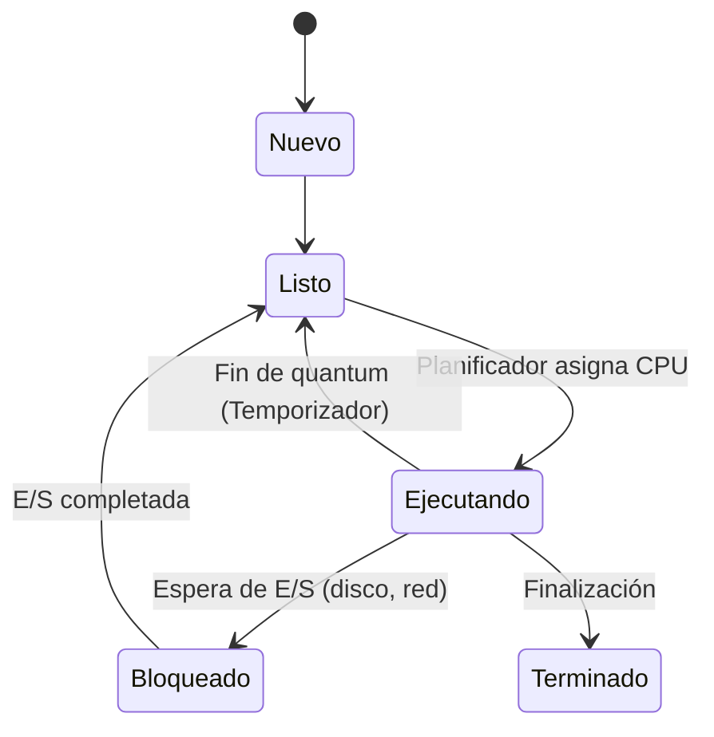

# DIWEB · Tema 0 — The Digital Blueprint: La Ilusión de la Multitarea

> 🏠 [[📚 Indice General]] ▸ [[DiseñoDeInterfacesWeb|Diseño de Interfaces Web]] │ 📄 Fuente: `The_Digital_Blueprint.pdf` │ ⬅️ [[DIWEB-T0-Resumen-Introduccion]] · [[DIWEB-T1-Planificacion-Interfaces]] ➡️

> Síntesis visual de **Arquitectura, Memoria y Procesos en el Modelo de Von Neumann**: un viaje desde el hardware físico hasta la inteligencia del Sistema Operativo.

## Índice
- [1. La Base: Arquitectura de Von Neumann](#1-la-base-arquitectura-de-von-neumann)
- [2. El Latido del Sistema: Ciclo de Instrucción y Pipeline](#2-el-latido-del-sistema-ciclo-de-instrucción-y-pipeline)
- [3. La Jerarquía de Memoria (Analogía de Tiempos)](#3-la-jerarquía-de-memoria-analogía-de-tiempos)
- [4. El Director de la Orquesta: El Sistema Operativo](#4-el-director-de-la-orquesta-el-sistema-operativo)
- [5. Programa vs. Proceso y Estados de un Proceso](#5-programa-vs-proceso-y-estados-de-un-proceso)
- [6. El Bloque de Control de Proceso (PCB)](#6-el-bloque-de-control-de-proceso-pcb)
- [7. El Cambio de Contexto (Context Switch) y su Costo Oculto](#7-el-cambio-de-contexto-context-switch-y-su-costo-oculto)
- [8. Gestión de Memoria, MMU, Paginación y Fallo de Página](#8-gestión-de-memoria-mmu-paginación-y-fallo-de-página)
- [9. Hilos (Threads): La Alternativa Ligera](#9-hilos-threads-la-alternativa-ligera)

---

## 1. La Base: Arquitectura de Von Neumann

- **Hardware base:** `CPU` (Unidad de Control + ALU) + `Memoria Principal` (Zona de ensamblaje) + `Entrada/Salida (E/S)` (Muelles de carga), conectados mediante **Buses de Datos, Direcciones y Control**.
- **El Principio fundamental:** el mismo espacio de memoria almacena tanto las **herramientas (código)** como los **materiales (datos)**.
- **El Cuello de Botella de Von Neumann:** la memoria principal es mucho más lenta que el procesador, por lo que la CPU pasa tiempo esperando lecturas (`Read`) y escrituras (`Write`).

---

## 2. El Latido del Sistema: Ciclo de Instrucción y Pipeline

Cada instrucción atraviesa **4 fases cíclicas**:
1. **Lectura (*Fetch*):** buscar la instrucción en memoria.
2. **Decodificación (*Decode*):** interpretar qué operación hay que hacer.
3. **Ejecución (*Execute*):** procesar la operación matemática o lógica en la ALU.
4. **Reescritura (*Writeback*):** guardar el resultado.

> [!tip] El Pipeline (Línea de Ensamblaje)
> Para no esperar a que una instrucción termine las 4 fases antes de empezar la siguiente, el procesador solapa las etapas en cadena:
> - `Instrucción 1`: **F**
> - `Instrucción 2`: **F → D**
> - `Instrucción 3`: **F → D → E**
> - `Instrucción 4`: **F → D → E → W**

---

## 3. La Jerarquía de Memoria (Analogía de Tiempos)

| Nivel | Tiempo real | Analogía a escala humana |
|---|---|---|
| **Registros CPU** | `0,25 ns` | **1 segundo** (alcanzar un papel sobre la mesa) |
| **Memoria Caché** | `5 ns` | **10 segundos** (ir a la habitación de al lado) |
| **Memoria RAM** | `100 ns` | **4 minutos** (caminar por la calle) |
| **Disco Duro / SSD** | `10 ms` | **4 días** (conducir por el país) |

> **Conclusión:** el procesador no puede permitirse «viajar 4 días» al disco duro para cada cálculo; necesita la caché y la RAM como niveles intermedios.

---

## 4. El Director de la Orquesta: El Sistema Operativo

El **Kernel** se sitúa entre las **Aplicaciones de Usuario** y el **Hardware físico** (`CPU`, `RAM`, `Discos`), operando con dos modos:
- **Modo Usuario (Restringido):** donde corren las aplicaciones sin acceso directo al hardware.
- **Modo Núcleo (Control Total):** donde ejecuta el Sistema Operativo.

Cumple dos papeles esenciales:
1. **El Administrador Justo:** reparte los recursos físicos limitados de manera equitativa entre todas las aplicaciones.
2. **El Gran Ilusionista:** hace creer a cada aplicación que tiene toda la memoria y la CPU para sí misma.

---

## 5. Programa vs. Proceso y Estados de un Proceso

| **Programa** | **Proceso** |
|---|---|
| **Entidad pasiva.** Código muerto y estático almacenado de forma permanente en el disco. | **Entidad activa.** Un programa en ejecución: un «ser vivo» que consume CPU y RAM con un estado dinámico. |

### Diagrama de estados de un proceso

> La CPU es demasiado rápida para esperar: si un proceso pide datos al disco duro, pasa a **Bloqueado** y el SO mete inmediatamente en la CPU al siguiente proceso de la cola **Listo**.

---

## 6. El Bloque de Control de Proceso (PCB)

El **PCB** (`struct task_struct`) es el expediente o **«CPU Virtual»** de cada proceso. Se divide en 4 bloques:
1. **Identificación:** `PID` (ID único del proceso) y `PPID` (ID del proceso padre).
2. **Estado Actual:** `Listo`, `Ejecutando` o `Bloqueado`.
3. **Contexto de Hardware:** copia de los registros de la CPU y del Contador de Programa (`PC`).
4. **Gestión y Recursos:** punteros de tablas de memoria y lista de archivos abiertos.

> Si un proceso es interrumpido, toda su memoria a corto plazo se guarda en el **PCB** para poder reanudarse exactamente donde se quedó.

---

## 7. El Cambio de Contexto (Context Switch) y su Costo Oculto

Cuando salta la **interrupción del temporizador** mientras corre el *Proceso A*:
1. El SO **guarda el estado** actual en el `PCB de A`.
2. El **planificador** elige al *Proceso B*.
3. El SO **restaura el estado** desde el `PCB de B` y *B* pasa a ejecutarse.

### La ecuación del costo oculto (Peaje Administrativo)
$$T_{\text{total}} = T_{\text{cómputo}} + \underbrace{(T_{\text{guardado}} + T_{\text{planificador}} + T_{\text{mmu}} + T_{\text{caché}})}_{\text{Peaje Administrativo}}$$

- $T_{\text{guardado}}$: guardar y restaurar PCBs.
- $T_{\text{planificador}}$: el SO decidiendo quién sigue.
- $T_{\text{mmu}}$: limpiar y reprogramar mapas de memoria (TLB).
- $T_{\text{caché}}$: el nuevo proceso sufre fallos al buscar datos en una **caché fría**.

> [!warning] Impuesto al rendimiento
> El cambio de contexto es necesario para la multitarea, pero es un impuesto al rendimiento: **no produce trabajo útil para el usuario**.

---

## 8. Gestión de Memoria, MMU, Paginación y Fallo de Página

- **MMU (Unidad de Gestión de Memoria):** los procesos creen que están solos y ven una **Memoria Lógica** lineal desde `0x0000`. La MMU actúa como traductor universal mapeando direcciones lógicas a direcciones de **Memoria Física (RAM real)** dispersas (`0x8000`, `0xBEEF`…), garantizando el aislamiento.
- **Paginación y Memoria Virtual:**
  - **Páginas (*Pages*):** el proceso lógico se divide en bloques de tamaño fijo.
  - **Marcos (*Frames*):** la RAM física se divide en casilleros del mismo tamaño.
  - **Memoria Virtual:** el SO carga en los marcos de la RAM solo las páginas que se están usando («la ventana mágica»); el resto duerme en el disco duro.
- **El Ciclo del Fallo de Página (*Page Fault*):**
  1. **Petición:** la CPU intenta acceder a una página.
  2. **¡Alerta MMU!:** entrada inválida (la página está en el disco).
  3. **Bloqueo:** el SO pausa el proceso.
  4. **Rescate:** el SO busca la página en el disco y la carga en la RAM (usando algoritmos **FIFO** o **LRU** para hacer espacio si la RAM está llena).
  5. **Reanudación:** el proceso reintenta la instrucción.

---

## 9. Hilos (Threads): La Alternativa Ligera

- **Procesos pesados:** cajas fuertes aisladas; cambiar de proceso es caro porque vacía cachés y reprograma la MMU.
- **Hilos (`TCB`):** múltiples flujos de ejecución dentro de un mismo proceso que **comparten la misma memoria virtual**, archivos y recursos. Cambiar entre hilos del mismo proceso minimiza la carga administrativa.

> **La Síntesis Final:** el Hardware (Von Neumann), el Administrador (SO) y las Estructuras de Datos (PCB y MMU) trabajan juntos en fracciones de milisegundo para transformar el silicio inerte en un entorno vivo, multitarea y aparentemente infinito.

---

## 🔗 Relacionado
- [[DiseñoDeInterfacesWeb|Diseño de Interfaces Web (Índice)]]
- [[DIWEB-T0-Resumen-Introduccion|Tema 0 · Conceptos Arquitectónicos y Sistemas Operativos]]
- [[DIWEB-T1-Planificacion-Interfaces|Tema 1 · Planificación de Interfaces Gráficas]]
- [[SI-Tema2|Estructura del Sistema y Gestión de Procesos (1º SI)]]

🏷️ #diweb #tema0 #arquitectura #von-neumann #procesos #memoria #mmu #2daw
