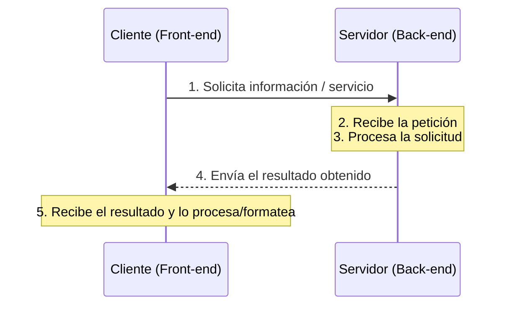

# DIWEB · Tema 2 — Arquitectura Cliente-Servidor

> 🏠 [[📚 Indice General]] ▸ [[DiseñoDeInterfacesWeb|Diseño de Interfaces Web]] │ 📄 Fuente: `ARQUITECTURA CLIENTE-SERVIDOR.pdf` │ ⬅️ [[DIWEB-T1-Teoria-del-Color]] · [[DIWEB-T2-Ocho-Ejemplos-HTML]] ➡️

## Índice
- [1. Concepto de Arquitectura Cliente/Servidor](#1-concepto-de-arquitectura-clienteservidor)
- [2. Características de un Sistema Cliente/Servidor](#2-características-de-un-sistema-clienteservidor)
- [3. Esquema de funcionamiento y elementos principales](#3-esquema-de-funcionamiento-y-elementos-principales)
  - [3.1. El proceso Cliente (Front-end)](#31-el-proceso-cliente-front-end)
  - [3.2. El proceso Servidor (Back-end)](#32-el-proceso-servidor-back-end)
- [4. Tipos de Arquitectura: Fat Client vs. Fat Server](#4-tipos-de-arquitectura-fat-client-vs-fat-server)
- [5. Tipos de Servidores](#5-tipos-de-servidores)

---

## 1. Concepto de Arquitectura Cliente/Servidor

La tecnología **Cliente/Servidor** es el procesamiento cooperativo de la información por medio de un conjunto de procesadores, en el cual múltiples clientes, distribuidos geográficamente, solicitan requerimientos a uno o más servidores centrales.

Desde el punto de vista funcional, se define como una **arquitectura distribuida** que permite a los usuarios finales obtener acceso a la información de forma transparente aun en entornos multiplataforma. Es la arquitectura más extendida en la realización de **Sistemas Distribuidos**.

---

## 2. Características de un Sistema Cliente/Servidor

Un sistema Cliente/Servidor se apoya en nueve principios fundamentales:

1. **Servicio:** unidad básica de diseño. El servidor proporciona los servicios y el cliente los utiliza.
2. **Recursos compartidos:** muchos clientes utilizan los mismos servidores y comparten a través de ellos recursos tanto lógicos como físicos.
3. **Protocolos asimétricos:** los clientes inician siempre las «conversaciones» (peticiones); los servidores esperan pasivamente su establecimiento.
4. **Transparencia de localización física:** el cliente no necesita saber dónde está ubicado físicamente el recurso que desea utilizar.
5. **Independencia de plataforma HW y SW:** clientes y servidores pueden operar sobre distinto hardware y sistemas operativos.
6. **Sistemas débilmente acoplados:** la interacción se basa en el envío de mensajes.
7. **Encapsulamiento de servicios:** los detalles internos de implementación de un servicio son transparentes para el cliente.
8. **Escalabilidad:**
   - **Horizontal:** añadir más clientes (o nodos).
   - **Vertical:** ampliar la potencia de los servidores centrales.
9. **Integridad:** mantener los datos y programas centralizados en los servidores facilita su integridad, seguridad y mantenimiento.

---

## 3. Esquema de funcionamiento y elementos principales

### 3.1. El proceso Cliente (*Front-end*)
Es todo proceso que reclama servicios de otro: permite al usuario formular los requerimientos y pasarlos al servidor. Normalmente maneja las funciones relacionadas con la manipulación y despliegue de datos sobre **interfaces gráficas de usuario (GUI)**.

**Funciones principales del cliente:**
- Administrar la interfaz de usuario.
- Interactuar con el usuario.
- Procesar parte de la lógica de la aplicación y realizar **validaciones locales**.
- Generar requerimientos de bases de datos.
- Recibir resultados del servidor y **formatearlos** para su visualización.

### 3.2. El proceso Servidor (*Back-end*)
Es todo proceso que proporciona un servicio a otros, encargado de atender a múltiples clientes que hacen peticiones de algún recurso administrado por él. Concentra la mayoría de las **reglas de negocio** y el acceso a los **recursos de datos**.

**Funciones principales del servidor:**
- Aceptar los requerimientos de bases de datos que hacen los clientes.
- Procesar requerimientos de bases de datos.
- Formatear datos para transmitirlos a los clientes.
- Procesar la lógica de negocio de la aplicación y realizar **validaciones a nivel de base de datos**.

---

## 4. Tipos de Arquitectura: Fat Client vs. Fat Server

| Modelo | Peso en el Cliente | Peso en el Servidor | Descripción |
|---|---|---|---|
| **Fat Client / Thin Server** (Cliente pesado) | Presentación + Lógica de aplicación | Datos (SGBD) | El peso de la aplicación se ejecuta en el cliente (presentación y aplicación corren en un único proceso cliente), relegando al servidor a las funciones de administración de base de datos. |
| **Fat Server / Thin Client** (Servidor pesado) | Solo Presentación (UI) | Lógica de aplicación + Datos | El proceso cliente se restringe a mostrar la interfaz de usuario, mientras que el grueso de la aplicación corre en el servidor de aplicaciones. |

---

## 5. Tipos de Servidores

1. **Servidores de Ficheros:**
   - El cliente solicita archivos completos a través de la red.
   - Es una forma primitiva de servicio de datos que requiere intercambiar muchos mensajes por la red para hallar el dato deseado.
   - Útil para crear repositorios compartidos de documentos, imágenes y archivos grandes.
2. **Servidores de Bases de Datos:**
   - Asociados a servidores relacionales **SQL** en arquitecturas de **dos o tres planos (capas)**.
   - El proceso cliente (o la capa de negocio) envía consultas SQL y recibe únicamente los registros necesarios.
3. **Servidores Web (World Wide Web):**
   - La primera aplicación Cliente/Servidor de alcance planetario.
   - Clientes simples (navegadores) se comunican con servidores Web mediante el protocolo **HTTP** (basado en petición/respuesta).
   - El servidor devuelve documentos (HTML, estilos, scripts, datos) cuando el cliente los solicita por su URL/nombre.

---

## 🔗 Relacionado
- [[DiseñoDeInterfacesWeb|Diseño de Interfaces Web (Índice)]]
- [[Tema 2 - Guía de estudio HTML y CSS|Tema 2 · Guía de estudio HTML y CSS]]
- [[DWEC-1.1|Modelos de ejecución Cliente/Servidor (DWEC)]]
- [[UT1|UT1 · Arquitecturas de desarrollo web (DWES)]]
- [[Despliegue-U1-Teoria|Unidad 1 · Implantación de arquitecturas web (Despliegue)]]

🏷️ #diweb #tema2 #arquitectura #cliente-servidor #http #2daw
