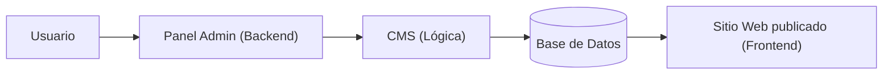

# Optativa · UD1 — Introducción al CMS y CDMON (Teoría Completa)

> 🏠 [[📚 Indice General]] ▸ [[Optativa|Optativa · Gestores de Contenido]] │ 📄 Fuente: `UD1. Introducción al CMS y CDMON.pdf` (Daniel Ocaña Aguilera) │ ➡️ [[Optativa-UD2-Teoria]]

## Índice
- [1.1. ¿Qué vamos a aprender?](#11-qué-vamos-a-aprender)
- [1.2. ¿Qué es un CMS?](#12-qué-es-un-cms)
  - [1.2.1. Arquitectura de un CMS (Cómo funciona por dentro)](#121-arquitectura-de-un-cms-cómo-funciona-por-dentro)
  - [1.2.2. Tipos de CMS](#122-tipos-de-cms)
- [1.3. WordPress en cifras](#13-wordpress-en-cifras)
- [1.4. CMS vs. Desarrollo a medida](#14-cms-vs-desarrollo-a-medida)
- [1.5. ¿Por qué WordPress? Criterios de elección](#15-por-qué-wordpress-criterios-de-elección)
- [1.6. CDMON — Características y ventajas](#16-cdmon--características-y-ventajas)
- [1.7. Proceso de instalación de WordPress en CDMON](#17-proceso-de-instalación-de-wordpress-en-cdmon)
- [1.8. Configuración inicial de WordPress](#18-configuración-inicial-de-wordpress)
- [1.9. Enlaces permanentes (Permalinks)](#19-enlaces-permanentes-permalinks)
- [1.10. Importancia SEO de los Permalinks](#110-importancia-seo-de-los-permalinks)

---

## 1.1. ¿Qué vamos a aprender?

- **Conceptos teóricos:**
  - Definir qué es un CMS y enumerar sus características principales.
  - Comparar ventajas y desventajas entre un CMS y el desarrollo a medida.
  - Identificar los diferentes tipos de CMS disponibles en el mercado.
- **Habilidades prácticas:**
  - Realizar una instalación completa de WordPress en CDMON.
  - Configurar los parámetros básicos del sitio web.
  - Establecer correctamente los enlaces permanentes (*permalinks*).
  - Verificar el correcto funcionamiento de la instalación.

---

## 1.2. ¿Qué es un CMS?

Un **CMS** (*Content Management System* o **Sistema de Gestión de Contenidos**) es una aplicación web que permite la creación, gestión y modificación de contenido digital sin necesidad de conocimientos técnicos especializados en programación.

**Características principales:**
- **Interfaz intuitiva:** panel de administración amigable.
- **Separación contenido-diseño:** los cambios de diseño (tema) no afectan al contenido almacenado.
- **Gestión de usuarios:** diferentes roles y niveles de permisos.
- **Workflow de publicación:** estados de borrador, revisión pendiente y publicación.
- **Extensiones:** plugins y temas para ampliar funcionalidades y apariencia.

**Flujo de trabajo típico:**

### 1.2.1. Arquitectura de un CMS (Cómo funciona por dentro)
Componentes esenciales:
1. **Base de datos (MySQL/MariaDB):** almacena todo el contenido (entradas, páginas, usuarios) y las configuraciones.
2. **Backend (`wp-admin`):** panel de administración privado para gestionar el contenido.
3. **Frontend:** parte pública visible para los visitantes del sitio.
4. **Tema / Plantilla (*Theme*):** define la apariencia visual y maquetación.
5. **Módulos / Plugins:** añaden funcionalidades específicas sin modificar el núcleo del CMS.

> [!tip] Ventaja clave
> El usuario solo interactúa con el **backend**; el CMS consulta la base de datos, aplica la plantilla activa y genera el **frontend** automáticamente.

### 1.2.2. Tipos de CMS

| Criterio de clasificación | Categorías y ejemplos |
|---|---|
| **Según su licencia** | - **Open Source (código abierto y gratuitos):** WordPress, Joomla, Drupal. - **Propietarios (código cerrado y de pago):** Adobe Experience Manager, Sitecore. |
| **Según su propósito** | - **Blogs y sitios web generales:** WordPress, Ghost. - **Comercio electrónico (*E-commerce*):** WooCommerce, PrestaShop, Magento. - **Portales empresariales:** Drupal, Liferay. - **Educación (*E-learning*):** Moodle, Chamilo. |
| **Según su tecnología base** | - **PHP:** WordPress, Joomla, Drupal. - **.NET:** Umbraco, Sitecore. - **Java:** Liferay, OpenCMS. |

---

## 1.3. WordPress en cifras

- **Cuota de mercado global:**
  - **43,5 %** de todos los sitios web de Internet usan WordPress.
  - **65,1 %** de cuota dentro del mercado de los CMS.
  - **35 %** de los sitios web en español utilizan WordPress.
- **Distribución por tipo de sitio:**
  - Blogs personales: **32 %**
  - Sitios corporativos: **28 %**
  - Tiendas online: **18 %**
  - Portales de noticias: **12 %**
  - Otros: **10 %**
- **Razones de su popularidad:**
  - Comunidad activa de más de **100.000 contribuidores**.
  - Más de **60.000 plugins gratuitos** en el repositorio oficial.
  - Actualizaciones de seguridad regulares.

---

## 1.4. CMS vs. Desarrollo a medida

| CMS (WordPress) | Desarrollo a medida (*Custom*) |
|---|---|
| ✅ Rápida implementación | ✅ Máxima personalización |
| ✅ Coste inicial bajo | ❌ Coste inicial más elevado |
| ✅ Actualizaciones automáticas | ❌ Mantenimiento complejo |
| ✅ Gran comunidad de soporte | ✅ Control total del código fuente |
| ❌ Limitaciones de diseño / arquitectura | ❌ Tiempo de desarrollo mayor |
| ❌ Dependencia de plugins de terceros | ✅ Optimización específica de rendimiento |

---

## 1.5. ¿Por qué WordPress? Criterios de elección

| Elegir un CMS (WordPress) cuando… | Elegir Desarrollo a medida cuando… |
|---|---|
| - Proyectos con presupuesto limitado. - Necesidad de lanzamiento rápido (*Time to Market*). - El cliente quiere gestionar el contenido autónomamente. - Proyectos de mediana complejidad. - No se necesitan funcionalidades técnicas muy específicas. | - Requerimientos técnicos muy específicos. - Grandes volúmenes de datos y concurrencia de usuarios. - Integraciones complejas con otros sistemas empresariales. - Aplicaciones web complejas (no centradas solo en contenido). - Máximos requisitos de seguridad y rendimiento a medida. |

---

## 1.6. CDMON — Características y ventajas

**Características del hosting CDMON (Plataforma de prueba educativa):**
- **Panel de control:** propio (*custom*) e intuitivo.
- **Almacenamiento:** desde 5 GB hasta ilimitado.
- **Correos electrónicos:** cuentas ilimitadas incluidas.
- **Certificado SSL:** gratuito incluido.
- **Bases de datos:** MySQL ilimitadas.
- **Dominio:** incluido en el plan del curso (`.mialias.net`).

**5 ventajas principales de CDMON:**
1. Hospedaje web español.
2. Panel de control intuitivo.
3. Instalador automático de WordPress en pocos clics.
4. Soporte técnico en español.
5. Dominio de pruebas gratuito incluido para el curso.

---

## 1.7. Proceso de instalación de WordPress en CDMON

1. Acceder al panel de control de **CDMON**.
2. Crear/seleccionar la plataforma de prueba y buscar el **«Instalador de aplicaciones»** (*Aplicaciones → WordPress*).
3. Seleccionar **WordPress**.
4. Elegir el dominio y el directorio de instalación.
5. Configurar los datos de administración y aceptar las políticas.
6. Completar la instalación automática y guardar las credenciales generadas (tanto las de acceso al hosting/página como las de `/wp-admin`).

---

## 1.8. Configuración inicial de WordPress

Primeros pasos tras instalar (`tudominio.com/wp-admin` → **Ajustes → Generales**):

| Ajuste | Función e importancia SEO/técnica |
|---|---|
| **Título del sitio** | Nombre oficial de la web. Aparece en la pestaña del navegador (`<title>`) y como titular en los resultados de búsqueda. |
| **Descripción breve** | Eslogan o resumen del sitio. Puede mostrarse en los *snippets* de Google (*meta description*). |
| **Dirección de WordPress (URL)** | Ruta donde residen los archivos del núcleo de WordPress. |
| **Dirección del sitio (URL)** | URL pública que escriben los visitantes para entrar en la web. |
| **Dirección de correo electrónico** | Correo del administrador para recibir notificaciones del sistema. |
| **Zona horaria** | `Europe/Madrid`. Crítica para la programación automática de publicaciones. |
| **Formato de fecha y hora** | Adaptado a las convenciones locales de la audiencia. |

---

## 1.9. Enlaces permanentes (Permalinks)

Los **Permalinks** (*enlaces permanentes*) definen la estructura de las URLs definitivas que apuntan a cada entrada o página del sitio (`Ajustes → Enlaces permanentes`):

| Opción | Ejemplo de URL | Valoración |
|---|---|---|
| **Simple (Default)** | `?p=123` | ❌ **No recomendado** (no aporta información al usuario ni al buscador). |
| **Día y nombre** | `/2024/09/24/sample-post/` | 🔶 Útil para periódicos o blogs de noticias diarias. |
| **Mes y nombre** | `/2024/09/sample-post/` | 🔶 Equilibrado para archivos cronológicos. |
| **Numérico** | `/archives/123` | ❌ Poco claro semánticamente. |
| **Nombre de la entrada** | `/sample-post/` | ✅ **Mejor opción para SEO** (limpia, corta y con palabras clave). |
| **Estructura personalizada** | `/%category%/%postname%/` | 🔧 Para usuarios avanzados o arquitecturas jerárquicas. |

---

## 1.10. Importancia SEO de los Permalinks

**Buenas prácticas para construir URLs amigables:**
1. **Incluir palabras clave:** `/marketing-digital/` en lugar de `/pagina1/`.
2. **Estructura lógica:** `/categoria/post-individual/`.
3. **Evitar caracteres especiales:** usar guiones medios (`-`) en vez de espacios, tildes o `ñ`.
4. **Mantener URLs cortas:** máximo 5–6 niveles de directorio.

**Comparativa:**
- ❌ `/?p=123`
- ❌ `/2024/09/24/como-configurar-wordpress-para-seo/` *(demasiado larga y atada a una fecha)*
- ✅ `/wordpress/configuracion-seo/`

**Impacto directo en el SEO:**
- Mejora la **experiencia de usuario** (sabe qué va a encontrar antes de hacer clic).
- Las URLs se muestran directamente en los **resultados de búsqueda (SERP)**.
- Las palabras clave presentes en la URL actúan como **factor de posicionamiento (ranking)**.

---

## 🔗 Relacionado
- [[Optativa|Optativa · Gestores de Contenido (Resumen rápido)]]
- [[Optativa-UD2-Teoria|UD2 · El Panel de Administración de WordPress]]
- [[UT1|UT1 · Arquitecturas de desarrollo web (DWES)]]
- [[Despliegue-U1-Teoria|Unidad 1 · Implantación de Arquitecturas Web y CMS (Despliegue)]]

🏷️ #optativa #ud1 #cms #wordpress #cdmon #seo #permalinks #2daw
