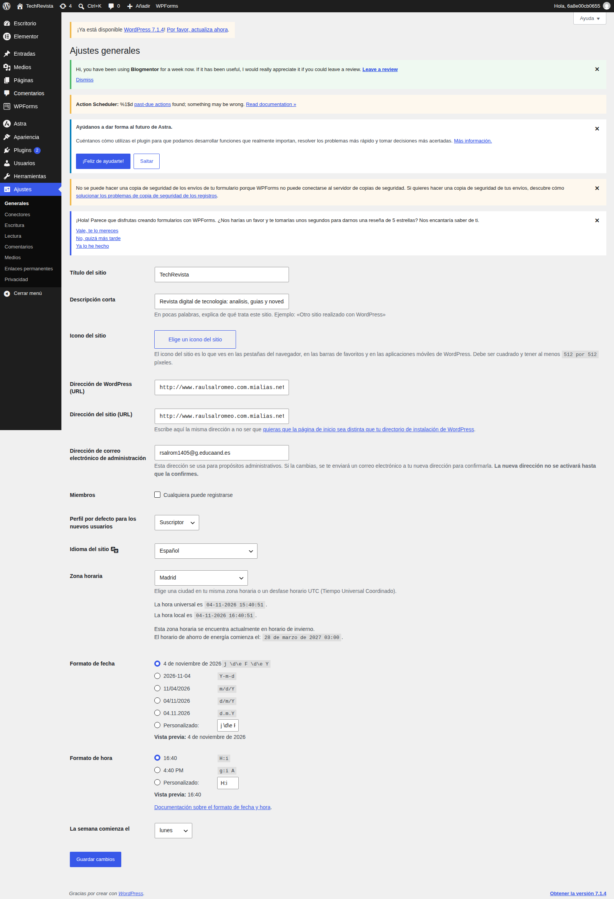
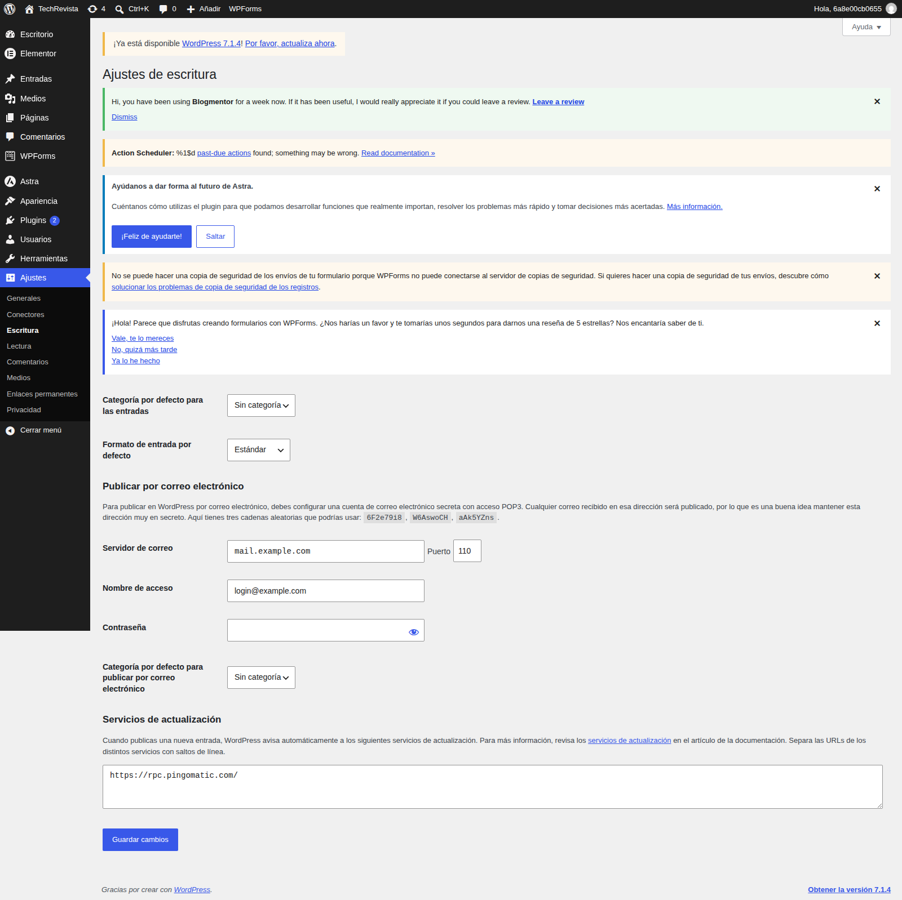
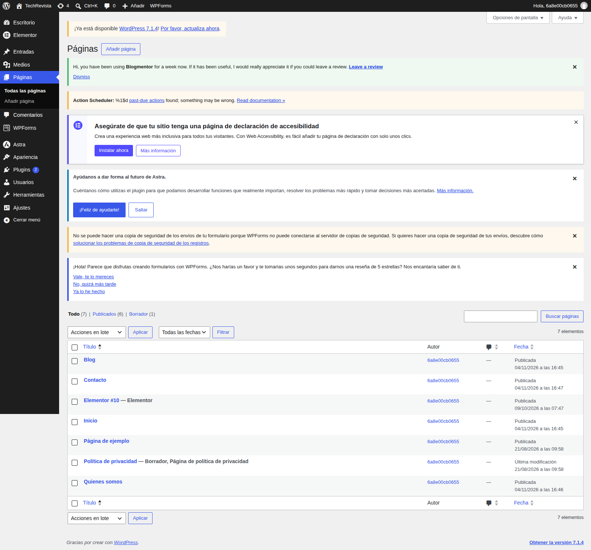
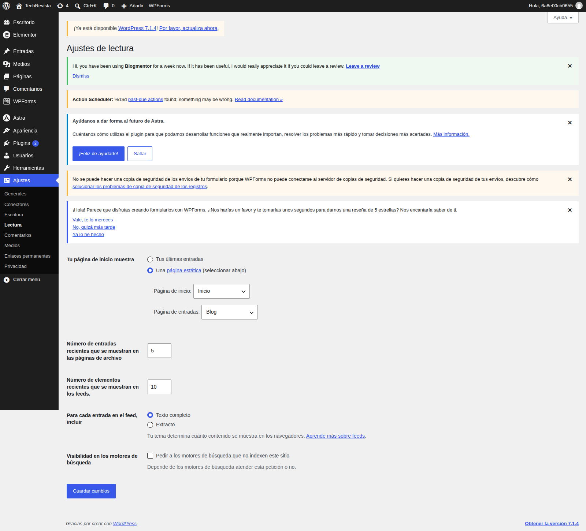
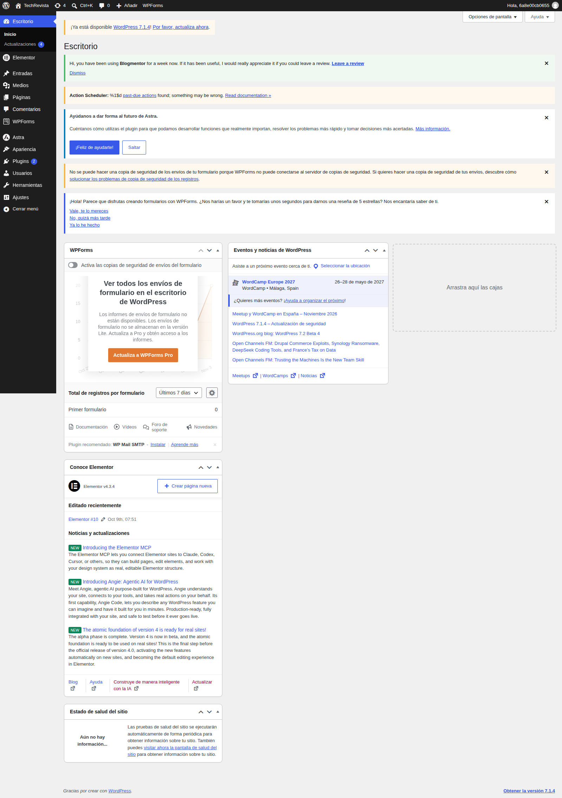
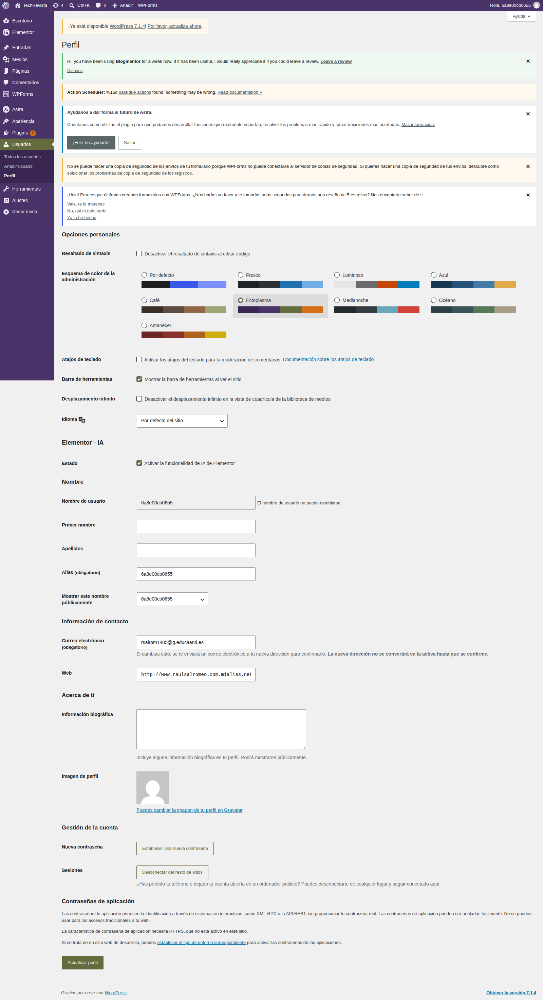
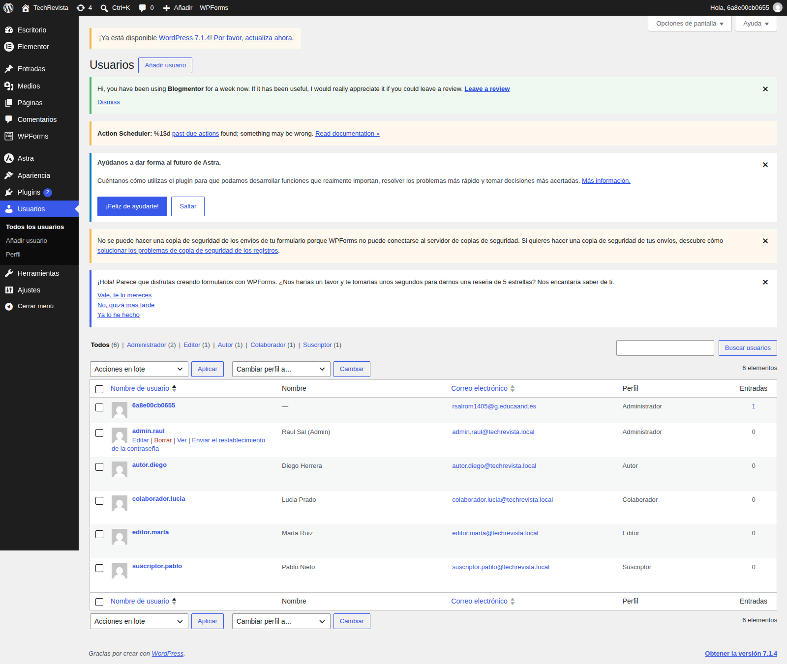
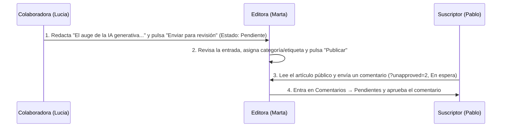

# Optativa · UD2 — Práctica 2: Configuración del Panel y Gestión de Usuarios en WordPress (*TechRevista*)

> 🏠 [[📚 Indice General]] ▸ [[Optativa|Optativa · Gestores de Contenido]] │ 📄 Fuentes: `Practica2.pdf` y `UD2_Practica_SalRomeo.pdf` │ ⬅️ [[Optativa-UD2-Teoria]]

> Documentación completa de la práctica realizada sobre la instalación real `http://www.raulsalromeo.com.mialias.net` con la temática **Revista Digital de Tecnología (*TechRevista*)**.

## Índice
- [Tarea 1: Configuración general del sitio (`Ajustes → Generales`)](#tarea-1-configuración-general-del-sitio-ajustes--generales)
- [Tarea 2: Configuración de escritura y lectura](#tarea-2-configuración-de-escritura-y-lectura)
- [Tarea 3: Personalización del escritorio y atajos](#tarea-3-personalización-del-escritorio-y-atajos)
- [Tarea 4: Gestión de usuarios y roles (`rol.nombre`)](#tarea-4-gestión-de-usuarios-y-roles-rolnombre)
- [Tarea 5: Verificación experimental de permisos por rol](#tarea-5-verificación-experimental-de-permisos-por-rol)
- [Tarea 6: Simulación de flujo de trabajo editorial completo](#tarea-6-simulación-de-flujo-de-trabajo-editorial-completo)
- [Conclusiones y resolución de incidencias](#conclusiones-y-resolución-de-incidencias)

---

## Tarea 1: Configuración general del sitio (`Ajustes → Generales`)

| Parámetro | Valor configurado |
|---|---|
| **Título del sitio** | `TechRevista` |
| **Descripción corta** | `Revista digital de tecnologia: analisis, guias y novedades del sector` |
| **Dirección de WordPress (URL)** | `http://www.raulsalromeo.com.mialias.net` |
| **Dirección del sitio (URL)** | `http://www.raulsalromeo.com.mialias.net` |
| **Zona horaria** | `Europa/Madrid (UTC+1)` |
| **Formato de fecha / hora** | `j de F de Y` / `H:i` |
| **Idioma del sitio** | `Español` |
| **Miembros (`Cualquiera puede registrarse`)** | **Desmarcado** |

- **¿Por qué se deshabilita el registro libre de usuarios?** Porque solo deben acceder al panel personas autorizadas por el administrador. Esto evita registros automatizados masivos (*bots*), spam y vectores de ataque aplicando el **principio de menor exposición**.
- **Diferencia entre «Dirección de WordPress (URL)» y «Dirección del sitio (URL)»:**
  - La **Dirección de WordPress** es la ruta del servidor donde residen los archivos del núcleo de WordPress.
  - La **Dirección del sitio** es la URL pública que escriben los visitantes en el navegador.
  - Son distintas cuando WordPress se instala en una subcarpeta (`/wordpress/`) pero se sirve desde la raíz del dominio, o durante migraciones/entornos de preproducción.

---

## Tarea 2: Configuración de escritura y lectura

### 2.1. Ajustes de Escritura (`Ajustes → Escritura`)
- **Categoría predeterminada:** *Sin categoría* (o categoría general del medio).
- **Servicio de actualización:** `https://rpc.pingomatic.com/`.
  - **¿Para qué sirve `rpc.pingomatic.com`?** Es un servicio centralizado de *ping* que avisa automáticamente a múltiples buscadores y agregadores de blogs cada vez que se publica contenido nuevo, acelerando su rastreo e indexación.

### 2.2. Creación de páginas estructurales y Ajustes de Lectura (`Ajustes → Lectura`)

Se publicaron 4 páginas base para estructurar el medio:
1. **`Inicio`**: portada estática de bienvenida a *TechRevista*.
2. **`Blog`**: página contenedora donde se listan dinámicamente las entradas.
3. **`Quiénes somos`**: descripción del medio y de su línea editorial.
4. **`Contacto`**: dirección de contacto y plazos de respuesta.

| Parámetro en `Ajustes → Lectura` | Valor |
|---|---|
| **Tu página de inicio muestra** | Una página estática (*Portada:* `Inicio` · *Página de entradas:* `Blog`) |
| **Número máximo de entradas en el sitio** | `5` |
| **Número máximo de entradas en el feed RSS** | `10` (mostrando solo el **Resumen**) |
| **Visibilidad en los motores de búsqueda** | **Desmarcado** (*permitir indexación*) |

> [!important] Indexación en producción
> La casilla *«Disuadir a los motores de búsqueda»* debe permanecer **desmarcada** en producción; si se activara, WordPress inyectaría `<meta name="robots" content="noindex, nofollow">` impidiendo que el sitio aparezca en Google.

---

## Tarea 3: Personalización del escritorio y atajos

1. **Opciones de pantalla:** se ocultaron tres widgets (*Estadísticas del sitio*, *Actividad* y *Borrador rápido*) para dejar un escritorio limpio.
2. **Esquema de color (`Usuarios → Tu perfil`):** se seleccionó el esquema **Ectoplasma**.
3. **Atajos de teclado verificados:**
   - `Shift + Alt + C` → Abre la sección de **Comentarios**.
   - `Shift + Alt + M` → Abre la **Biblioteca de medios**.
   - `Shift + Alt + P` → Abre el editor de **Nueva entrada**.

---

## Tarea 4: Gestión de usuarios y roles (`rol.nombre`)

Se crearon **5 cuentas** (una por rol), evitando el usuario inseguro `admin`, utilizando contraseñas de más de 12 caracteres y separando el **login** del **Nombre público para mostrar**:

| Rol | Usuario (login) | Nombre público | Correo | Responsabilidad en *TechRevista* |
|---|---|---|---|---|
| **Administrador** | `admin.raul` | Raul Sal (Admin) | `admin.raul@techrevista.local` | Responsable de TI y dirección técnica del medio |
| **Editor** | `editor.marta` | Marta Ruiz | `editor.marta@techrevista.local` | Responsable de contenidos, revisión y calidad editorial |
| **Autor** | `autor.diego` | Diego Herrera | `autor.diego@techrevista.local` | Redactor en plantilla de la sección de hardware |
| **Colaborador** | `colaborador.lucia` | Lucia Prado | `colaborador.lucia@techrevista.local` | Colaboradora externa esporádica |
| **Suscriptor** | `suscriptor.pablo` | Pablo Nieto | `suscriptor.pablo@techrevista.local` | Lector registrado para comentar artículos |

- **Biografías configuradas:**
  - *Editora (Marta Ruiz):* «Responsable de contenidos de TechRevista. Licenciada en Periodismo, con más de ocho años de experiencia cubriendo tecnología, privacidad y derechos digitales.»
  - *Autor (Diego Herrera):* «Redactor de la sección de hardware y movilidad. Analiza dispositivos, compara componentes y sigue de cerca la actualidad del sector.»

---

## Tarea 5: Verificación experimental de permisos por rol

Se inició sesión con cada cuenta para comprobar qué muestra el menú lateral y cómo responde el backend ante accesos directos por URL:

1. **Colaborador (`colaborador.lucia`):** al redactar una entrada no aparece el botón *Publicar*, sino únicamente **«Enviar para revisión»**. No ve *Medios*, *Páginas*, *Plugins*, *Usuarios* ni *Ajustes*.
2. **Autor (`autor.diego`):** dispone del botón **«Publicar»** para sus propias entradas y acceso a **Medios**, pero no puede editar entradas ajenas ni entrar a *Páginas*, *Ajustes* o *Usuarios*.
3. **Editor (`editor.marta`):** ve todo el bloque de contenido (*Entradas, Categorías, Etiquetas, Medios, Páginas, Comentarios*), pero no ve *Ajustes* ni *Usuarios*. Al intentar forzar la URL en el navegador (`/wp-admin/options-general.php` o `/wp-admin/users.php`), el backend bloquea la petición con error de permisos.
4. **Suscriptor (`suscriptor.pablo`):** solo ve *Escritorio* y *Perfil*.

| Acción comprobada | Admin | Editor | Autor | Colaborador | Suscriptor | ¿Coincide con la teoría? |
|---|:---:|:---:|:---:|:---:|:---:|:---:|
| Publicar entradas propias | Sí | Sí | Sí | No | No | ✅ Sí |
| Editar entradas ajenas | Sí | Sí | No | No | No | ✅ Sí |
| Enviar a revisión | Sí | Sí | Sí | Sí | No | ✅ Sí |
| Moderar comentarios | Sí | Sí | No | No | No | ✅ Sí |
| Acceso a Ajustes | Sí | No | No | No | No | ✅ Sí |
| Acceso a Usuarios | Sí | No | No | No | No | ✅ Sí |
| Comentar artículos | Sí | Sí | Sí | Sí | Sí | ✅ Sí |
| Gestionar perfil propio | Sí | Sí | Sí | Sí | Sí | ✅ Sí |

---

## Tarea 6: Simulación de flujo de trabajo editorial completo

1. **Paso 1 (Colaboradora):** `colaborador.lucia` redacta el artículo *«El auge de la IA generativa en el desarrollo web»* y lo envía a revisión (`capturas/Tarea6_1_Colaborador_Revision.png`).
2. **Paso 2 (Editora):** `editor.marta` localiza la entrada como *Pendiente*, la revisa, la clasifica y la publica (`capturas/Tarea6_2_Editor_Publica.png`).
3. **Paso 3 (Suscriptor):** `suscriptor.pablo` comenta la noticia publicada; el comentario queda retenido pendiente de moderación (`capturas/Tarea6_3_Suscriptor_Comentario.png`).
4. **Paso 4 (Editora):** `editor.marta` aprueba el comentario desde `Comentarios → Pendientes` y queda público (`capturas/Tarea6_4_Editor_Aprueba.png`).

---

## Conclusiones y resolución de incidencias

- **Doble capa de autenticación en CDMON:** el hosting de prueba protege el dominio con una autenticación HTTP previa e independiente del login de WordPress (`/wp-admin`).
- **Seguridad en el backend:** los roles de WordPress aplican control de acceso en el servidor, no solo ocultación visual en el menú.
- **Separación login / firma pública:** configurar siempre el *Nombre para mostrar* evita exponer el identificador de acceso de los redactores.

---

## 🔗 Relacionado
- [[Optativa|Optativa · Gestores de Contenido (Índice)]]
- [[Optativa-UD2-Teoria|UD2 · El Panel de Administración de WordPress (Teoría)]]
- [[Optativa-UD1-Practica1|UD1 · Práctica 1: Instalación en CDMON]]

🏷️ #optativa #ud2 #practica #wordpress #roles #usuarios #flujo-editorial #2daw
